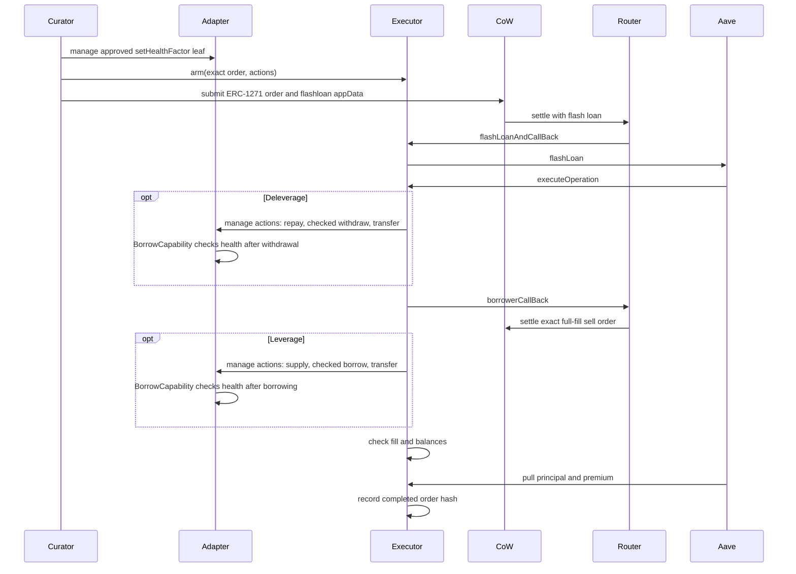

# CoW position execution

`CoWPositionExecutor` is one contract for Aave V3 and Morpho Blue leverage and deleverage. It reuses the existing Merkle adapter's `manage` calls, CoW's deployed `FlashLoanRouter`, and Aave's flash lender. One shared `BorrowCapability` protects borrowing and collateral withdrawal through approved strategy leaves; health policy stays in the adapter.



## Hashing

Order digests use the vendored [CoW `GPv2Order` library](https://github.com/cowprotocol/contracts/blob/c07a93e3596194c5e3cf331c755a3f9f0e4a17d8/src/contracts/libraries/GPv2Order.sol) at `src/libraries/GPv2Order.sol`. It is copied from commit `c07a93e3596194c5e3cf331c755a3f9f0e4a17d8`; only the ERC-20 import and formatting are adapted. The upstream LGPL-3.0-or-later notice and license are retained in `src/libraries/GPv2Order.LICENSE`; its required companion GPLv3 text is in `src/libraries/GPv2Order.GPL-3.0.LICENSE`. Hashing logic is unchanged.

`CoWSwapCapability` uses the same library for its adapter-owned, partially fillable orders. It retains presigning: the executor is a separate order owner, and the adapter's ERC-1271 selector is already used by `LiquidLaneRedeemCapability`. Sharing signature dispatch would add code and change the capability configuration.

## Authorization and accounting

- The immutable owner arms one order at a time. Activity is derived from the order hash, last completed hash and expiry; the UID is derived from the hash, executor address and expiry. Its getter returns empty bytes before the first order. The executor becomes available again after completion or expiry; there is no early cancellation. Expiry revokes the signature, and rearming clears the previous sell-token allowance. Re-arming the last completed order leaves its signature inactive and allowance zero, allowing a fresh order immediately. All protocol calls run through `manage`, which verifies proofs against the current accepted root and checks the executor's leaf roles. The executor does not store or pin a root; proofs invalidated by a root change and revoked roles fail in the adapter.
- Actions use the adapter's `uint96 value` field and zero/nonzero leaf marker. CoW position actions require zero native value.
- `isValidSignature` validates the active committed EIP-712 hash even before the flash callback, allowing CoW's independent order admission check. Signature bytes are unused. Orders are ERC-1271, SELL, fill-or-kill, receiver = executor, fee = zero, ERC-20 balances. Approval is bounded to the exact sell amount.
- The router entry authenticates the router and borrows the committed token and principal from the immutable lender; all three router loan metadata fields are unused. A busy flag prevents nested arming or router entry. The lender callback authenticates the lender and executor initiator, and enforces the premium ceiling. The trusted Aave pool supplies the requested loan, passes the actual flash-loan caller as initiator, requires the callback and collects repayment before returning. The trusted CoW router authenticates its callback data. These immutable dependencies must be trusted instances.
- Leverage sells flash-borrowed debt tokens, supplies the bought collateral, borrows debt and returns repayment funds to the executor. Deleverage repays debt first, withdraws collateral and sells it for repayment funds.
- The executor commits the action amounts when armed. Approved `borrow(target, healthFactorTarget, data, healthFactorData)` leaves fix both targets and the complete health query while allowing the nested lending amount to vary. The actual amount is passed unchanged; no marker or substitution is used. Bought collateral above the minimum and unused premium buffers return to the adapter. Its starting liquid balances in both order tokens cannot decrease.
- The executor requires a full UID fill, exact sold balance delta and minimum bought delta. It has no health-check field, query or call. A single installed `BorrowCapability` executes approved borrowing and collateral-withdrawal calls, then queries the pinned scalar health reader. `AaveHealthFactor.getHealthFactor(pool, adapter)` and `MorphoBlueHealthFactor.getHealthFactor(morpho, marketId, adapter)` each return one `uint256`; no response offset is configured.
- The holder of the approved `setHealthFactor(healthFactorId, minimum)` leaf role can update the minimum through `manage`, including after an executor is armed. The leaf fixes the query ID and permits the minimum to vary; its role is separate from the executor's lending roles. Each complete health query has an independent adapter-local minimum. Minimum updates grant no lending permission: new targets, markets, assets, recipients and query templates still require proposed and accepted leaves. Missing minimums block execution.
- Health is checked after each wrapped lending operation, before later actions. On deleverage, this is before CoW settlement; on leverage, it is after settlement and the borrowing call. There is no final health check after the whole settlement. Strategy proposals must route every permitted health-worsening operation through the checked capability, including collateral withdrawals; equivalent unchecked leaves would bypass the minimum. Supply and repayment may remain direct.
- Completion is recorded only after the lender returns following repayment. CoW hooks are not responsible for finalization. Any failure reverts the enclosing flash transaction. Successful execution returns surplus order tokens to the adapter. There is no independent token recovery; unrelated tokens accidentally sent to the executor may remain stranded.

Malformed calldata, invalid proofs, insufficient repayment and failed health checks revert during execution. CoW validates the active signature and prevents order replay. The executor also checks actual balance deltas, so omitting an already-filled order cannot reuse its cumulative fill marker. Arming requires positive order amounts and zero native action value; it does not preflight every downstream call. An invalid order can therefore occupy the executor until expiry. The frontend validates and reviews the constructed intent before arming.

## Deployment

The factory uses the existing `ImmutableFactory` unchanged. The script deploys its fixed executor creation code and the stateless Aave and Morpho scalar health readers:

```sh
forge script script/deploy/merkle/DeployCoWPosition.s.sol:DeployCoWPositionScript \
  --rpc-url "$ETH_RPC_URL" --account "$ACCOUNT" --sender "$SENDER"
```

This command simulates; add `--broadcast` only for an intended deployment. The factory itself has no administrator. Curator-created instances use `factory.create(abi.encode(owner, adapter, router, lender))`; use the intended curator Safe as owner from creation.

The constructor assigns its inputs without explicit validation and reads the settlement and vault relayer from the router. Deployment configuration must supply the intended addresses.

For Ethereum the verified fork dependencies are CoW router `0x9da8B48441583a2b93e2eF8213aAD0EC0b392C69`, settlement `0x9008D19f58AAbD9eD0D60971565AA8510560ab41`, and the configured Aave V3 flash-loan pool. Confirm the router remains an authorized solver before deploying another network configuration.

## Validation

- Unit tests cover canonical hash/UID parity, authorization, exact fill, callback spoofing, expiry and rearming across token pairs, loan repayment and atomic rollback. A stateful invariant exercises arm/execute/expire cycles.
- Checked borrowing and withdrawals are exercised through the production Merkle adapter and installed `BorrowCapability`. Tests change the curator's minimum after arming and reuse a borrowing leaf with a different amount. Health-query decoding, query-keyed role-authorized minimum updates, and pinned calldata are covered by the capability tests.
- `CoWPositionExecutorMainnet.t.sol` exercises all four Aave/Morpho and leverage/deleverage combinations at Ethereum block 25,982,370 against deployed CoW router/settlement and protocol contracts. It also covers health-failure and revoked-leaf rollback, and third-party flash-loan initiation rejection. The executor starts unfunded. The Morpho market and deterministic oracle are local fixtures on the real Blue contract.
- Foundry 1.8.1 gas snapshots record executor method/path measurements in `snapshots/CoWPositionExecutor.json`; `snapshots/sizes.txt` records compiled bytecode sizes. These are isolated fixture measurements, not live transaction estimates.

Live CoW API admission, solver selection and a funded production settlement have not been exercised. The live version endpoint reported `v2.379.1@4ffd14cd1fc9b28779268ed7abae7e414b802bcd8`; its source includes the ERC-1271 zero-balance admission path with real allowance. This is supporting source evidence, not a successful production order.
