# Merkle automation strategies

Design catalog, reviewed on **2026-09-28** against adapters `bd5e235`, curator-backend `7b236339`, and merkle-executor `29e16b08`.

The recommended foundation is a shared liquidity policy: **recover endangered debt, meet withdrawals, replenish cash reserves, then invest surplus**. Liquid Lane, 3F, lending and issuer positions should reuse the same funding and settlement actions. Each asynchronous order or redemption is a separate tracked obligation; a request receipt is not available cash.

The trees below describe desired automation behavior. A diamond can represent an off-chain decision between separately approved recipes. It does not imply that the on-chain interpreter supports arbitrary branching or catches failed protocol calls.

## Strategy list

| ID                                                              | Automation                                           | Trigger                                             | Starting point                                                      |
| --------------------------------------------------------------- | ---------------------------------------------------- | --------------------------------------------------- | ------------------------------------------------------------------- |
| [L1](#l1-obtain-a-required-asset)                               | Obtain liquidity from an ordered source list         | A strategy needs an exact asset and amount          | Existing funding builder; borrowing is additional composition       |
| [L2](#l2-fulfil-vault-withdrawals)                              | Return cash to the adapter and complete withdrawals  | Outstanding deallocation demand                     | Adapter primitives; coordinated settlement needed                   |
| [L3](#l3-maintain-an-operating-cash-buffer)                     | Maintain an operating cash buffer                    | Cash outside configured bands                       | Custom recipes and shared reservation policy                        |
| [Y1](#y1-deposit-surplus-into-liquid-markets)                   | Deposit surplus into vaults/markets                  | Unreserved cash above the buffer                    | Existing deposit operations                                         |
| [Y2](#y2-rebalance-liquid-venues)                               | Rebalance lending venues                             | Exposure or net return outside policy               | Custom recipes; ranking needed                                      |
| [Y3](#y3-buy-or-subscribe-to-rwas)                              | Buy/stake/subscribe to RWA positions, including sUSN | Approved allocation has room                        | Existing issuer operations; asynchronous follow-up needed           |
| [Y4](#y4-buy-liquid-lane-inventory-and-optionally-redeem)       | Buy discounted LL inventory; optionally redeem       | Eligible, worthwhile signed offer                   | Existing LL recipe/provider; quote producer integration needed      |
| [Y5](#y5-fund-3f-requests-and-recycle-proceeds)                 | Fund 3F requests and recycle proceeds                | Authorized request meets policy                     | Existing mint recipe; discovery and settlement orchestration needed |
| [Y6](#y6-borrow-and-buy-rwas)                                   | Borrow against collateral and buy RWA                | Stressed carry and liquidity requirements pass      | Narrow `lending` preset; broader combinations need recipes          |
| [U1](#u1-convert-assets-through-cow-swap)                       | Convert proceeds through CoW Swap                    | Cash is in the wrong token                          | Existing asynchronous provider                                      |
| [U2](#u2-claim-merkl-rewards)                                   | Claim Merkl rewards and route proceeds               | Claimable rewards justify execution                 | Existing provider; destination recipe needed                        |
| [U3](#u3-claim-redemptions-and-sweep-issuer-payouts)            | Claim matured redemptions / sweep issuer payouts     | Owned entitlement is ready or payout has arrived    | Existing providers for selected issuers                             |
| [U4](#u4-schedule-redemptions-and-cooldowns-ahead-of-demand)    | Schedule redemptions, epochs and cooldowns           | Forecast cash need enters the exit lead time        | Supported exit actions; scheduler and cursors needed                |
| [R1](#r1-start-health-recovery-before-liquidity-becomes-urgent) | Begin early health recovery and RWA redemption       | Health warning or stressed future repayment gap     | Low-level recovery builder; issuer normalization needed             |
| [R2](#r2-repay-urgently-or-add-collateral)                      | Urgent repayment / collateral top-up                 | Critical health or immediate liquidation risk       | Recovery preset plus dedicated idle-cash/top-up recipes             |
| [R3](#r3-repay-debt-and-distribute-realized-cash)               | Repay debt and distribute realized cash              | Cash arrives or debt becomes uneconomic             | Existing repay/deposit/funding operations                           |
| [R4](#r4-prepare-for-debt-maturity-or-refinancing)              | Prepare for maturity or refinance debt               | Maturity approaches or debt cost rises              | Custom orchestration; Midnight integration missing                  |
| [R5](#r5-stop-new-risk-and-unwind-an-exposure)                  | Stop new risk and unwind exposure                    | Limit breach, depeg, oracle/issuer/venue incident   | Existing control/exit primitives; coordinated response needed       |
| [E1](#e1-sell-existing-inventory-through-liquid-lane)           | Sell held inventory through LL consumer RFQ          | Early sale is better than waiting for redemption    | Permission support; dedicated executor provider missing             |
| [E2](#e2-bridge-a-withdrawal-with-bounded-borrowing)            | Bridge a withdrawal with bounded borrowing           | Near-term cash gap with a credible repayment source | Optional extension; not a default funding fallback                  |

“Existing” means implemented building blocks, not a deployed or enabled strategy. Every route still needs its chain deployment, account permissions, committed recipe, configured provider and current protocol eligibility. The backend's code-owned mainnet Merkle deployment entries are not populated at this revision. See the [deployment registry][backend-deployments].

## What we can compose today

| Protocol / connector                                 | Useful actions                                                                                        | Actual integration boundary                                                                                                                    |
| ---------------------------------------------------- | ----------------------------------------------------------------------------------------------------- | ---------------------------------------------------------------------------------------------------------------------------------------------- |
| MerkleAdapter / MerkleAccount                        | Push free adapter cash to account; pull account cash back; stage and synchronize withdrawal liquidity | Positions and managed protocol calls belong to the account. Vault settlement remains report-gated.                                             |
| ERC-4626, including Morpho Vault V2 and Euler EVault | Deposit, withdraw, redeem                                                                             | Morpho V2 needs its dedicated liquidity calculation. Generic share value is not immediately withdrawable cash.                                 |
| Aave V3                                              | Supply, withdraw, collateral controls, borrow, repay                                                  | Compiler support exists. Withdrawal helpers do not size borrowing, and the debt-aware helper does not enforce a curator's higher health floor. |
| Aave V4                                              | Query supplied-position withdrawal capacity                                                           | Helper exists; no debt-aware helper or served V4 action/borrowing compiler. New reviewed integration is needed.                                |
| Morpho Blue                                          | Supply collateral, borrow, repay, withdraw collateral; health checks                                  | Backend `morpho_market` means Blue, not Vault V2. No backend loan-side supply operation or borrowing-capacity optimizer.                       |
| Morpho Midnight                                      | Maturity-aware health query                                                                           | Contract helper exists; no served permission/compiler route.                                                                                   |
| Euler borrowing                                      | Deposit collateral, EVC setup, borrow, repay, close                                                   | Debt-vault/controller and collateral configuration must match; preserve all affected positions' health.                                        |
| Liquid Lane connector                                | Buy connector-held RWA with the account's payment token                                               | Buyer/liquidity-provider side. The field `outputAsset` names the payment token; `token` is the RWA received.                                   |
| Liquid Lane consumer / Reactor                       | Sign an inventory sale and cancel its nonce                                                           | Seller side. Separate asynchronous flow; dedicated Go provider is missing.                                                                     |
| 3F                                                   | Fund an authorized request, mint PT/YT, burn when withdrawal is allowed                               | Policy and mint template exist; no dedicated Go discovery/lifecycle provider.                                                                  |
| CoW Swap                                             | Approve and authorize a bounded order, reconcile settlement                                           | Current provider implements asynchronous full-fill sell orders. Not an atomic exchange step.                                                   |
| Merkl                                                | Claim account rewards with verified proofs                                                            | Go provider exists. Proof/calldata shape must fit the approved leaves.                                                                         |
| RWA issuers                                          | Purchase, request exit, claim or receive payout                                                       | Support differs between the backend catalog, Go provider and contract fork tests; see below.                                                   |

There are no dedicated Pendle, Uniswap, Curve, Balancer or AMM liquidity-provision compiler routes. Buying their tokens through CoW or adding a reviewed generic leaf is separate from native strategy integration.

Sources: [permission types][backend-catalog], [recipe presets and filters][backend-recipes], [liquidity helpers](LIQUIDITY-SOURCES.md), [health helpers](BORROW-HEALTH-FACTORS.md), [executor providers][providers].

### Issuer routes and waiting states

| Family                      | Useful strategy path                                                        | Coverage / settlement distinction                                                                                                                                       |
| --------------------------- | --------------------------------------------------------------------------- | ----------------------------------------------------------------------------------------------------------------------------------------------------------------------- |
| Midas                       | Buy or subscribe; redeem through the specific enabled instant/request route | Backend has selected purchase and redemption routes. Go `redemptions` currently submits requests; issuer-driven payout requires a later cash sweep.                     |
| Centrifuge                  | Request subscription → claim shares; request redemption → claim cash        | Backend and Go exit support. Purchase claims use asset-denominated `maxDeposit`; redemption claims use share-denominated `maxRedeem`. Pending shares are not cash.      |
| OpenEden HYBOND             | Subscribe → receive position; request exit → issuer pays                    | Backend and Go request support. No user claim call on this route; validate the current payout token.                                                                    |
| Hastra / Figure             | USDC → wYLDS → PRIME; PRIME → wYLDS → request USDC                          | Backend purchases and Go redemption support. PRIME unwrap is synchronous; wYLDS payout is asynchronous.                                                                 |
| Noon sUSN                   | USN → sUSN; request → wait → claim USN                                      | Backend and Go support. USN and sUSN use 18 decimals. No USDC/USN issuance or redemption bridge is supplied by this route.                                              |
| Pareto                      | Request in the appropriate epoch phase → claim eligible epoch/receipt       | Go provider exists; not a backend issuer-catalog route. Queue claims need an explicit epoch.                                                                            |
| Securitize                  | Transfer to redemption wallet, or use a supported atomic off-ramp           | Go provider exists; not a backend issuer-catalog route. Wallet receipt proves submission only. Atomic off-ramps must deliver the configured settlement token.           |
| GAIB, Theo, 3Jane, InfiniFi | Unstake, request, redeem or start unwinding according to product            | Broader contract/fork compatibility; served compiler and dedicated Go provider integration absent. sUSD3 instant redemption consumes already-matured cooldown capacity. |
| Lido, Ether.fi, Makina      | Request an exit, track owned receipt/NFT, later claim                       | Broader contract/fork compatibility; complete automation integrations absent. Required NFT receiver capability must be installed.                                       |
| Superstate, Spiko           | Submit issuer burn/escrow request, then reconcile actual settlement         | Broader contract/fork compatibility. Off-chain payout needs explicit reconciliation; it is not an on-chain cash claim.                                                  |
| DigiFT bEQTY                | Potential issuer exit                                                       | Blocked/unproven in the recorded fork matrix; exclude from enabled strategies.                                                                                          |

The [backend issuer table][backend-rwas], [Go LL asset catalog][ll-assets], [Go Securitize catalog][securitize-assets] and [broader fork matrix](RECIPE-REDEMPTIONS.md) are different coverage sets. An interface, a successful fork request or a catalog entry does not establish live enrollment, executable liquidity, final payout or complete NAV coverage. Enable an asset only when its held position, pending entitlement and any debt can be valued by the configured NAV workflow.

## Common rules for every tree

- Track **NAV**, **spendable cash**, **reserved cash**, **outstanding debt** and **pending issuer entitlements** separately. Borrowing adds cash and a liability; internal transfers do not create profit. Staged/released withdrawal reserves remain part of NAV.
- Keep a shared reservation ledger for withdrawals, signed orders, debt service and promised strategy funding. Do not subtract overlapping reservations twice. Do not let two strategies spend the same balance or assign one redemption to two obligations.
- Approve fixed venues, assets, recipients, amount bounds and health floors. Bind runtime amounts to those bounds, verify actual balance/debt/receipt changes, and clear residual temporary approvals where the route permits it.
- Capacity estimates are planning bounds. A failed read, protocol call or recipe assertion reverts the entire transaction; there is no automatic try-the-next-market-on-revert behavior. A pre-read zero capacity can skip its configured action group.
- Asynchronous arrows cross transaction boundaries. A confirmed issuer request frees the keeper's account lock, but remains pending at the issuer. An active CoW job holds the same-account lock through fill/expiry. Current keeper scheduling has no emergency preemption.
- Prefer independent jobs for independently maturing claims. One provider returning “not ready” prevents the entire combined job from submitting. Merkl's narrowly scoped optional skip does not make unrelated issuer claims optional.
- The keeper polls fixed configurations. Opportunity ranking, forecast buffers, request-ID/epoch cursors, cross-strategy reservations and priority dispatch below are proposed coordination, not existing automatic behavior.
- Errors terminate the attempt and require reconciliation before retry. Confirmed reverted executor transactions halt that strategy for inspection; never retry by inventing a new order/request before reconciling the original.

Suggested configurable values: cash lower/target/upper bands; withdrawal and debt-service horizons; minimum trade/claim size; per-transaction and period budgets; issuer/venue exposure caps; maximum outstanding requests; slippage and quote age; settlement deadline; and health warning/critical/target levels. Accounting and approvals use token base units; apply each protocol's ABI normalization separately. Midas purchase amounts and some redemption floors use 18-decimal protocol amounts even for USDC. Existing numeric health helpers use `1e18` for the liquidation boundary; a configured safety margin must sit above it and reflect the assets and exit delays.

The source-waterfall builder currently consumes account idle cash, then optional free adapter cash, then ordered external sources. It does **not** preserve a discretionary account cash floor or coordinate reservations by itself. Add committed guards and the reservation policy before using it for unrestricted investment loops. See [ExecutingRecipe](../script/recipes/ExecutingRecipe.sol) and [execution semantics](RECIPE-EXECUTOR.md).

## Liquidity

### L1. Obtain a required asset

**Trigger:** an approved downstream action needs token `T` and amount `N`.

Use available account `T`, then free adapter `T` if `T` is the vault underlying, then safe synchronous withdrawals in curator-selected order. Morpho Vault V2, Aave V3, reviewed Aave V4 positions and Euler/ERC-4626 sources have different capacity queries. Claiming ready proceeds can precede expensive withdrawals when it is independently executable. Borrow only through a separately enabled policy; it is not ordinary “idle liquidity.”

**Deliver:** measured `T` for the downstream action, or an explicit shortfall. An all-or-nothing purchase must revert if funding is insufficient; withdrawal/recovery strategies may retain explicitly designed partial progress.

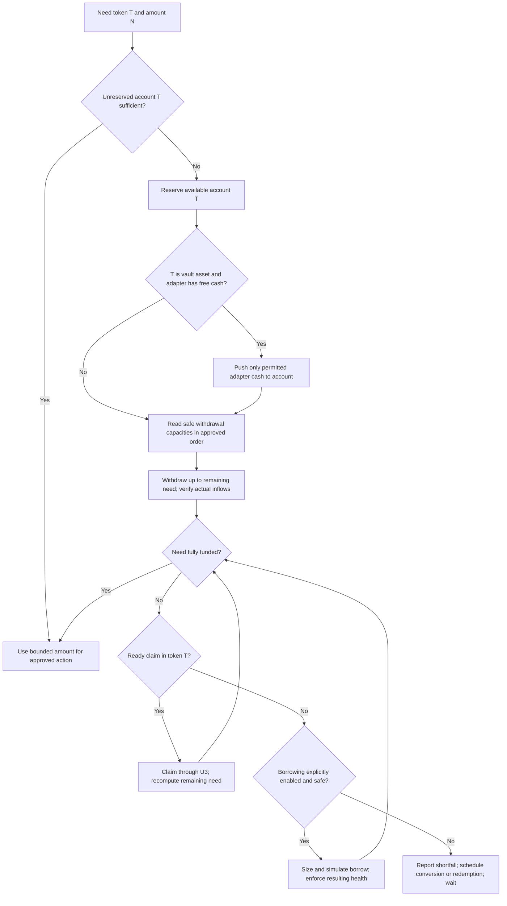

**Support:** ordered non-borrow funding exists. Borrow sizing is off-chain; helpers expose withdrawal capacity, not borrow capacity. Aave V3's debt-aware estimate protects the protocol boundary, so stricter leaf guards still apply. The Aave V4 helper is suitable only with separately established debt/health safety and reviewed execution leaves; no V4 compiler preset exists.

### L2. Fulfil vault withdrawals

**Trigger:** outstanding deallocation demand. First use released adapter cash; otherwise return available underlying from the account or source it through L1/U3/U1/U4.

**Deliver:** cash in the vault through its delegator flow. `pull()` moves account → adapter and stages against demand. It does not itself complete a vault withdrawal. Only the delegator calls `deallocate()`; its subsequent vault push transfers adapter cash to the vault.

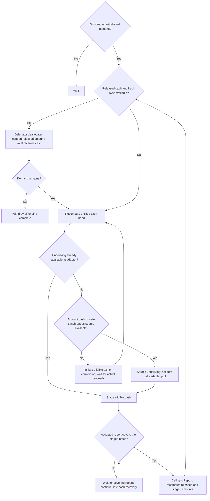

**Support:** primitives exist; orchestration must track cumulative staging checkpoints and accepted reports. Cash staged through the accepted snapshot releases together; cash staged after that snapshot needs a later report. Without accepted NAV, account recovery and pull/stage against existing demand remain possible, but settlement through the production delegator is blocked. A rejected candidate report does not cover staged cash. Cancelling demand does not free already staged/released reserves for reinvestment. See [adapter accounting](MERKLE-ADAPTER.md) and [MerkleAdapter](../src/contracts/MerkleAdapter.sol).

### L3. Maintain an operating cash buffer

**Trigger:** spendable cash falls below a lower band or rises above an upper band. The target should cover forecast withdrawals, debt service and active commitments without counting the same reservation twice.

**Deliver:** a target cash balance with hysteresis, avoiding repeated withdraw/deposit churn. Keep emergency repayment liquidity in the debt asset; an RWA or outstanding CoW quote is not that buffer.

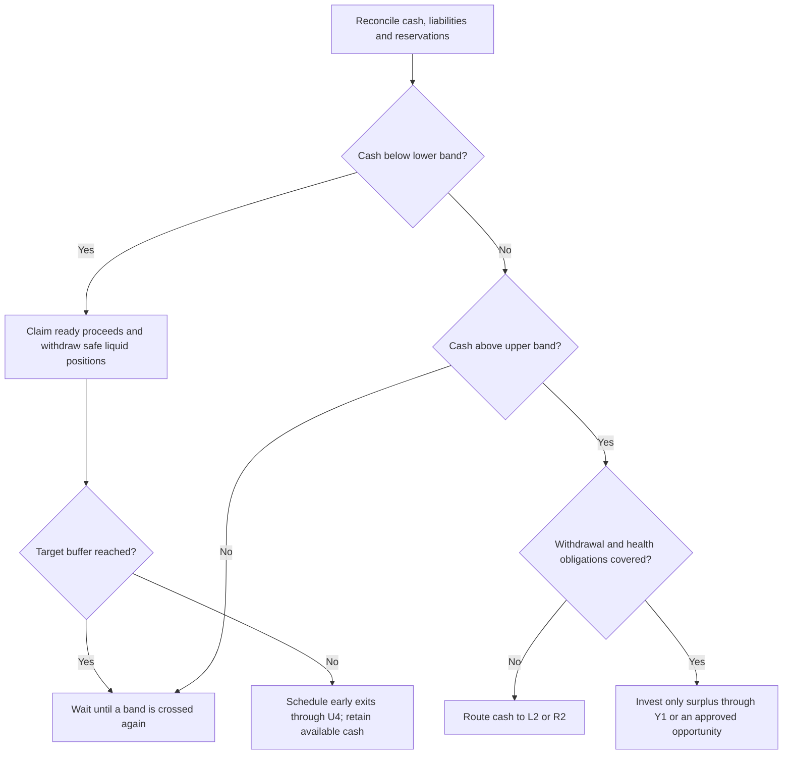

**Support:** custom recipe and coordination work. Do not assume the existing LL/3F funding helper preserves this buffer automatically.

## Investment and carry

### Y1. Deposit surplus into liquid markets

**Trigger:** account cash exceeds reserved amounts and the target buffer.

Deposit to an approved ERC-4626/Morpho V2/Euler vault or Aave V3 market, respecting venue concentration and deposit limits. Use a configured destination order, with overflow to the next eligible venue. Aave V4 requires additional compiler/leaf integration. Morpho Blue collateral supply is not a substitute for a loan-token yield deposit.

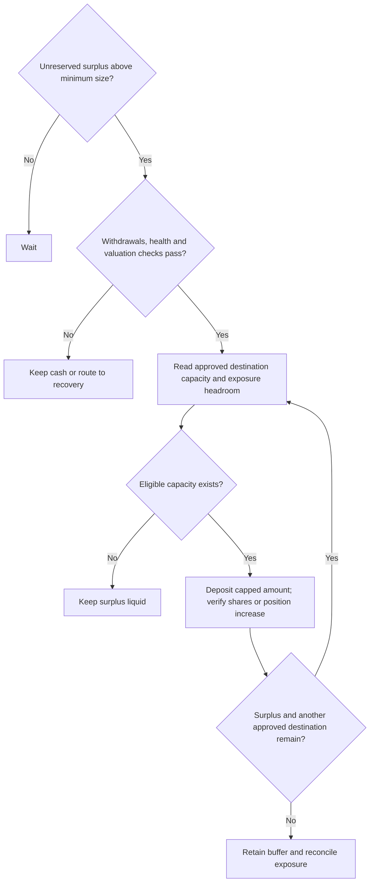

**Support:** deposit operations and fixed recipes exist. Capacity allocation can be committed across a finite list; the diagram does not require a runtime interpreter loop. Morpho V2 allocations may not all be available through its ordinary withdrawal path, so select by exit liquidity as well as expected yield. [Morpho V2 architecture](https://docs.morpho.org/learn/concepts/vault-v2/).

### Y2. Rebalance liquid venues

**Trigger:** a venue exceeds its allocation band, risk limit changes, or another approved venue offers enough additional expected return after switching costs.

Withdraw the safely available part, then deposit within the destination's remaining cap. Keep a minimum dwell time and a material benefit threshold. Cross-token moves use U1 and reserve proceeds for a later deposit; same-token moves can be atomic.

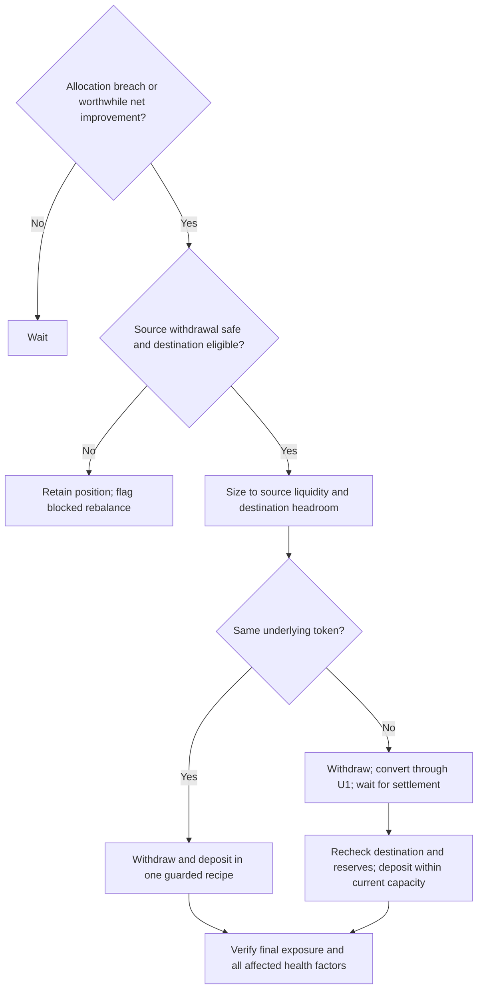

**Support:** custom fixed-venue recipes. Dynamic APR ranking, common risk scoring and economic thresholds are additional planner logic. A quote alone is insufficient to justify moving funds.

### Y3. Buy or subscribe to RWAs

**Trigger:** an approved asset allocation has room, the cash horizon accommodates its exit, and the issuer route is eligible.

Use a direct instant purchase/staking route where available; otherwise submit a subscription and later claim/observe issued shares. Examples are Midas purchases, Centrifuge subscriptions, OpenEden subscriptions, USDC → wYLDS → PRIME, and **USN → sUSN**. Buying sUSN with USDC first needs a separately supported conversion into USN.

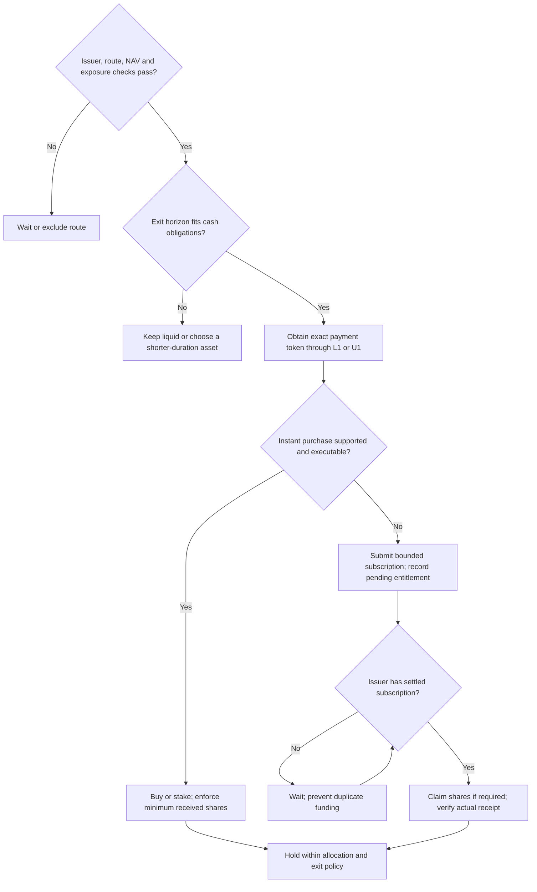

**Support:** selected backend issuer operations exist. The Go redemption provider does not provide a general purchase/subscription lifecycle; use an approved recipe and add the relevant tracking. Ordinary ERC-4626 purchases, including wYLDS, PRIME and sUSN, have no `minOut` argument: the desired minimum-share floor needs an additional committed check or the compatible `lending` preset's output-ratio guard. A positive share increase alone is insufficient. The narrow `lending` preset accepts simple input-sized instant purchase routes and explicitly excludes Midas; it is not a generic issuer-buy compiler. [Issuer routes][backend-rwas], [compiler restrictions][backend-resolve].

### Y4. Buy Liquid Lane inventory and optionally redeem

**Trigger:** a selected connector-compatible signed offer has positive conservative net value and fits inventory, oracle, budget, exposure and cash constraints.

L1 supplies the **payment token**; the connector sends RWA inventory to the account. Then either hold it under Y3's allocation policy or consume only the newly acquired amount through a verified issuer exit. Value the discount after redemption fees, holding time, financing, conversion and settlement uncertainty. A minimum signed discount is not a complete profitability test.

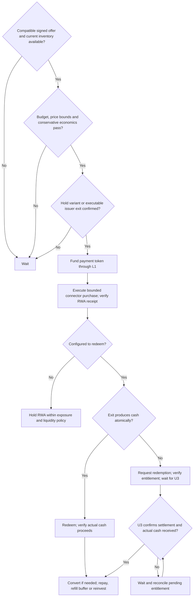

**Support:** contract builder and Go provider exist; the served `ll-executing` preset buys and holds, while optional redemption needs additional composition. The current sibling RFQ producer signs the older adapter domain, incompatible with the connector provider; a matching producer must be integrated. The provider's `maxAmountOut` preparation check must be backed by execution-time payment bounds. Connector budgets are keyed by RWA token and charged in payment-token units. See [LLExecuting](../script/recipes/LLExecuting.sol) and [provider boundary][providers].

### Y5. Fund 3F requests and recycle proceeds

**Trigger:** an approved request exposes account mint authorization and meets request yield, funding budget, aggregate exposure and liquidity-horizon limits.

Read authorized principal/yield, obtain the matching funding token, charge the correct policy and mint with exact cash/PT/YT movement checks. When `canWithdraw()` permits withdrawal, use the approved burn/settlement operation and allocate actual proceeds through R3. A claimed position does not refund the policy's fixed-period funding budget.

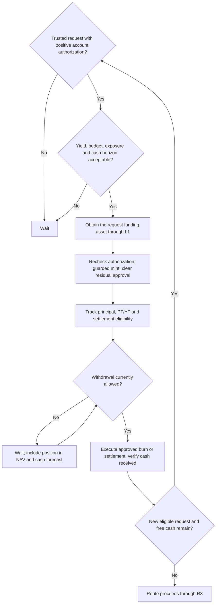

**Support:** mint template/policy and backend burn operation exist; opportunity discovery and settlement scheduling need orchestration. `minYieldPerRequest` is a per-request ratio scaled by `1e8`, not APY. Policy budget keys use the position-manager collateral underlying while amounts use request funding-token units. Requests sharing a collateral-underlying budget must use the same funding token and denomination; otherwise use separate policies. Period flow caps are not outstanding-exposure caps. See [ThreeFPolicy](../src/contracts/merkle-adapter/capabilities/policies/ThreeFPolicy.sol) and [ThreeFExecuting](../script/recipes/ThreeFExecuting.sol).

### Y6. Borrow and buy RWAs

**Trigger:** conservative expected settlement value exceeds purchase cost, stressed borrowing cost over a delayed settlement horizon, conversion cost, fees and the required risk margin.

Supply eligible collateral, borrow a bounded amount, then buy the approved RWA. The same design can fund LL or 3F, but those are separately committed recipes. Require enough immediately available repayment capacity to survive the modeled delay; asynchronous assets cannot be the sole urgent repayment source. Do not enable recursive leverage by default.

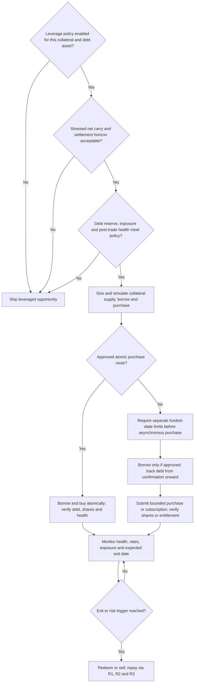

**Support:** the served `lending` preset is Aave supply/borrow plus a compatible instant issuer purchase, with matching assets and one purchase amount slot. Broader Aave/Blue/Euler → LL/3F/issuer combinations need custom reviewed recipes. Aave V4 and Midnight need additional integration. There is no generic borrow-capacity optimizer, guaranteed positive spread or atomic CoW-financed purchase.

## Utilities and settlement

### U1. Convert assets through CoW Swap

**Trigger:** settled, unreserved assets are in the wrong denomination: redeemed USDC for a USDT vault, reward tokens for repayment, or USN proceeds for a different vault underlying.

Authorize a bounded sell order with fixed token pair, account receiver, minimum output and short policy-approved validity. Wait for confirmed settlement before any dependent pull, repayment or deposit. Do not treat stablecoin denominations as interchangeable at par.

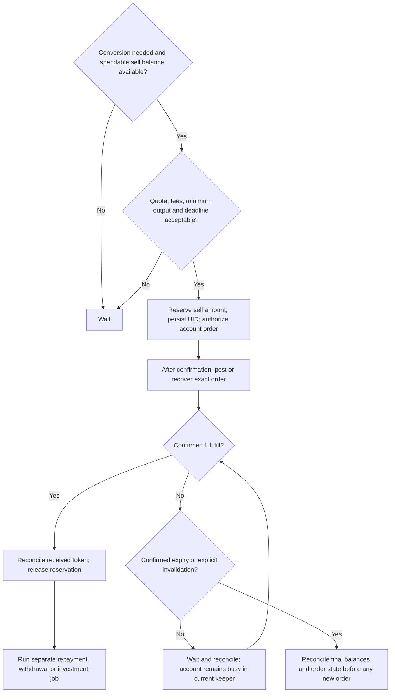

**Support:** existing provider handles full fill/expiry; active emergency cancellation needs a separate control/reconciliation path. Expiry completes the current job, whereas observed invalidation returns an error and retains its account lock until operator recovery. Root or role changes do not revoke a saved account signature. API “fulfilled” is insufficient; preserve canonical settlement evidence. CoW authorization and reinvestment cannot be one atomic recipe. [Provider implementation][providers]; [CoW settlement semantics](https://docs.cow.fi/cow-protocol/reference/contracts/core/settlement).

### U2. Claim Merkl rewards

**Trigger:** verified unclaimed rewards exceed a configured threshold and are worth the transaction cost.

Claim to the account, verify the actual received amount and route it to urgent debt, withdrawals, cash reserves or reinvestment. Different reward tokens can be accumulated until U1 becomes economical. Thresholds must account for token value and gas; the existing provider's raw token minimum does not calculate profitability.

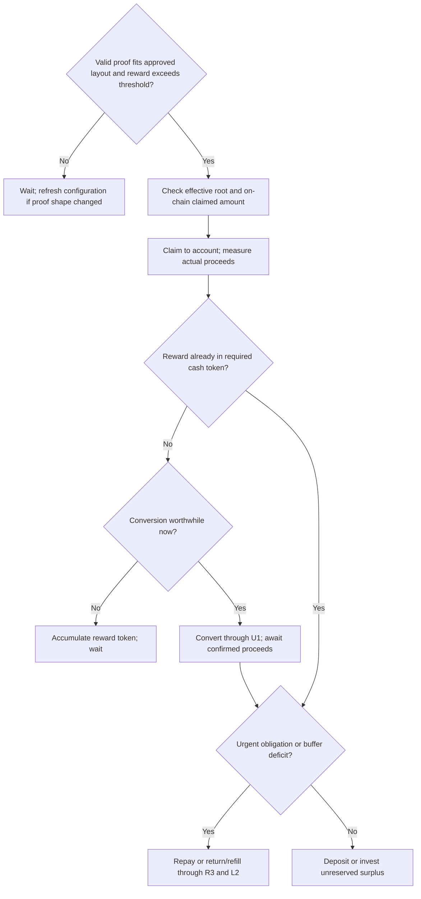

**Support:** provider exists, destination policy needs a recipe. Optional no-reward skipping is restricted to its dedicated single-token claim group. Changed proof depth may require new approved calldata layout; malformed data must fail rather than be treated as an empty reward.

### U3. Claim redemptions and sweep issuer payouts

**Trigger:** an owned entitlement is claimable, or issuer-paid tokens have actually arrived.

Dispatch by route: Centrifuge claimable shares; Pareto eligible epoch/receipt; Noon explicit request ID; or issuer-push payment with no user claim. Use independent jobs so an immature Noon request does not prevent another issuer's ready claim. Re-read debt and withdrawal need after receiving proceeds.

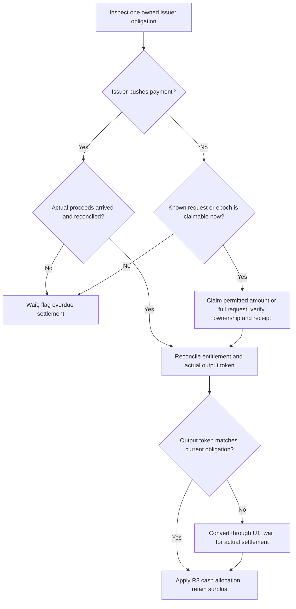

**Support:** Go providers cover selected routes, including Noon, Pareto and Securitize. Noon requires an explicit `requestId` (zero is valid), applies the handler's **current** withdrawal period and pays **USN**. Pareto queue claims require an explicit epoch. There is no automatic ID/epoch cursor. The backend `health-claim` preset fits amount-based settled claims such as Centrifuge; Noon ID-based claims need their own recipe. Except Figure's supported unwrap binding, prepared issuer calldata must remain consistent with provider reconciliation; do not silently resize requests inside the recipe. [Issuer provider details][ll-assets].

### U4. Schedule redemptions and cooldowns ahead of demand

**Trigger:** forecast withdrawals, repayment or allocation reduction enter an asset's conservative exit lead time.

Subtract distinct pending entitlements already assigned to that need, including matured but unclaimed requests, before queuing more. Chunk redemptions across eligible issuers/epochs, cap outstanding exposure, and track ownership, IDs, maturity and output token. Possible routes include sUSN, Pareto, Centrifuge, 3F when eligible, and the broader cooldown/unstaking integrations listed above.

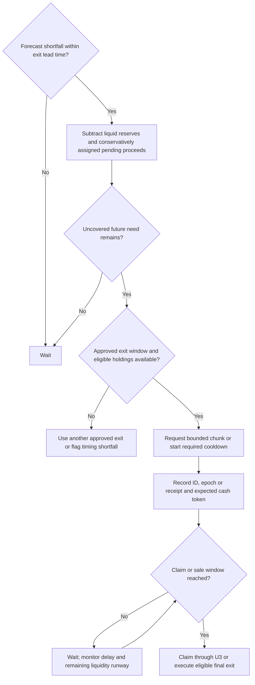

**Support:** several request/claim actions exist; forecasting, rolling epoch selection and request discovery need orchestration. Do not assume a cooldown grants instant exit to newly purchased shares. Some routes have one outstanding request, changing withdrawal periods, limited claim windows, off-chain processing or NFT requirements. A queued receipt only reduces planned duplicate requests; it does not reduce current cash need.

## Risk and debt management

### R1. Start health recovery before liquidity becomes urgent

**Trigger:** health crosses a warning level, stressed collateral/debt prices imply a future shortfall, or the cash runway becomes shorter than conservative redemption latency.

Repay from safe liquid sources first, then request RWA exits for the uncovered future need. Start well before the critical level: a redemption requested today may take longer than the remaining liquidation runway. Reassess delays and repayment requirements each run.

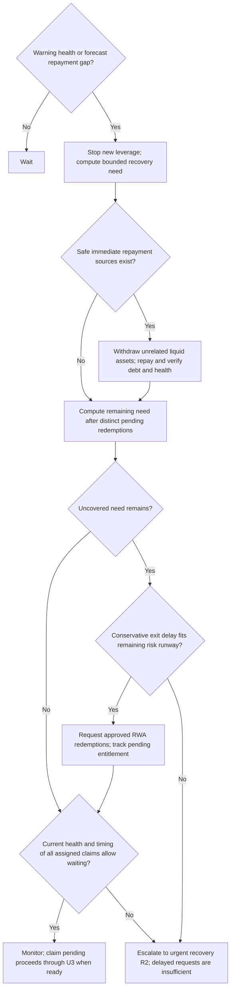

**Support:** the low-level [recovery builder](HEALTH-RECOVERY-RECIPE.md) supports withdrawal → repayment → ordered requests; the served `health-recovery` preset currently leaves its redemption list empty. Adding issuer-specific pending/claim queries is necessary. Existing recovery sizing assumes one debt asset and unchanged collateral; it preserves old cash and repays newly sourced cash. Pending claims do not improve HF, and partial progress does not guarantee the target is reached.

### R2. Repay urgently or add collateral

**Trigger:** critical health or an immediate solvency threat. Prioritize currently executable actions; do not wait for CoW or an issuer queue to create urgent cash.

Use an approved idle-debt-token repayment recipe, safe withdrawal from unrelated liquid positions, or eligible unencumbered collateral top-up. Never withdraw the protected position's backing collateral through the simple recovery template. Check every affected debt position, including protocol subaccounts.

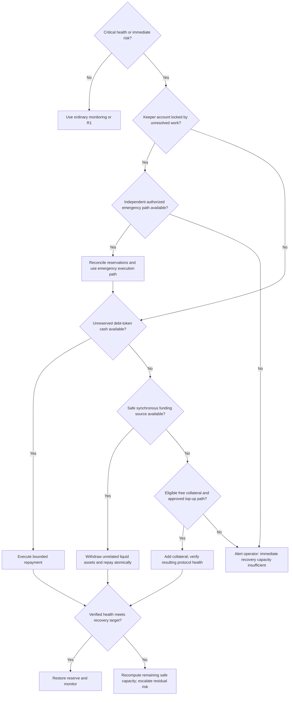

**Support:** Aave/Euler source-funded recovery preset exists. Idle-cash repayment and top-up require their own approved recipes. Current keeper cannot preempt an account's pending CoW job; an independently authorized emergency path and reservation reconciliation must be designed before relying on this protection. No flash-loan deleveraging or generic collateral-sale rescue is implemented. Repayment and additional collateral can improve health, but the appropriate target depends on the assets and liquidation parameters. [Aave health-factor mechanics](https://aave.com/help/borrowing/liquidations).

### R3. Repay debt and distribute realized cash

**Trigger:** issuer claims, 3F settlement, rewards, a sale or investment exit creates actual cash; or holding cash while paying borrowing costs is no longer justified.

Route cash by obligation: urgent debt recovery, already committed withdrawals, due/planned debt service, target buffer, then approved surplus investment. Preserve adapter withdrawal reserves. For a leveraged opportunity, reconcile principal and interest before labeling residual cash as profit; reduce debt without exceeding the actual debt or safe cash amount.

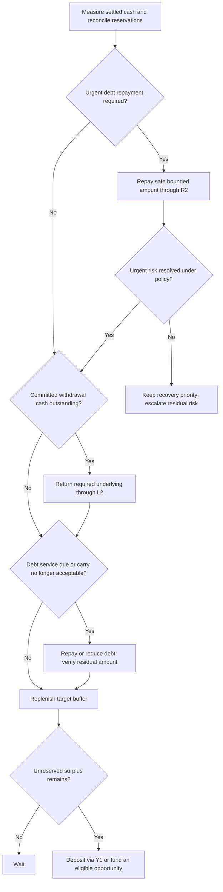

**Support:** individual operations exist; the shared allocation policy and dispatch need composition. If the cash is in another token, U1 introduces a settlement wait before dependent repayment or withdrawal. Do not count an anticipated claim or an unfilled sell order as realized cash.

### R4. Prepare for debt maturity or refinancing

**Trigger:** debt maturity enters a safety window, a facility may cease rolling, or existing borrowing becomes materially more expensive than an approved alternative.

Prefer repayment from cash or early asset exits. Refinance only with verified destination liquidity, repayment currency, permissions and safe health throughout the move. Never assume future rollover is available. Morpho Midnight needs specific maturity handling and additional compiler integration.

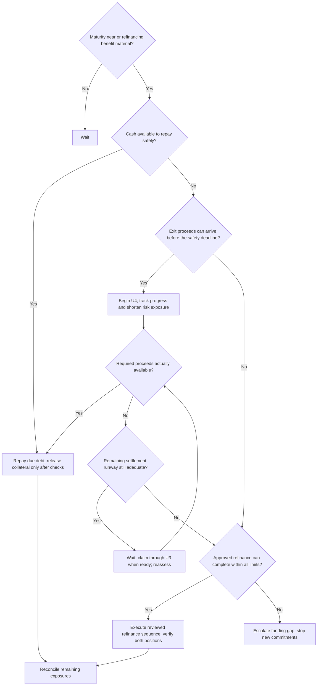

**Support:** debt reads and repayment primitives are available for integrated markets; general refinancing is an extension. No atomic flash-loan migration is implied. Midnight's health helper returns zero for unpaid matured debt, so an ordinary price-only HF trigger is insufficient.

### R5. Stop new risk and unwind an exposure

**Trigger:** issuer/venue concentration breach, depeg, price/NAV freshness failure, protocol incident or curator decision to exit.

Stop new purchases/borrowing for the affected exposure, reconcile active jobs and saved signatures, then withdraw, sell or redeem through the safest currently eligible route. Keep claim/repay/return paths available where they reduce risk. A bad price feed should not cause an unconditional sale at an unbounded price.

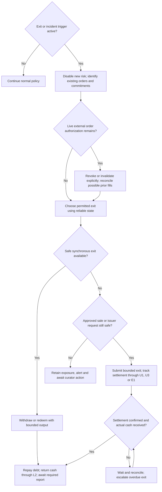

**Support:** control and exit primitives exist; priority dispatch, cancellation service and incident policy need implementation. Changing a root, role or executor caller does not revoke already saved account signatures. An oracle report rejected by movement bounds does not automatically freeze the oracle; it preserves the prior accepted report. Do not invent NAV to finish an exit.

## Optional extensions

### E1. Sell existing inventory through Liquid Lane

**Trigger:** an approved consumer-side offer provides acceptable proceeds sooner or more economically than issuer redemption.

This is the account selling its existing RWA inventory through a Reactor request. It is distinct from Y4, where the connector sells inventory to the account. Reserve the offered inventory, enforce minimum output and expiry, and release it only after fill or confirmed cancellation/expiry.

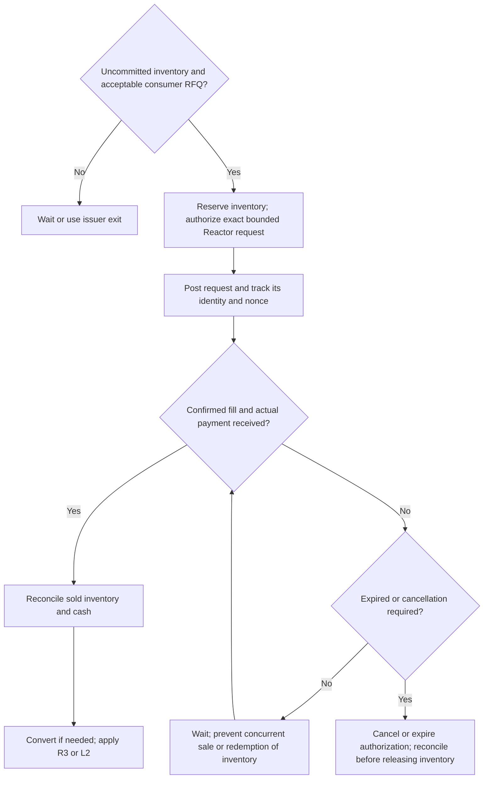

**Support:** backend permission/signing and nonce-cancellation operations exist. The Go executor has no dedicated consumer request-posting/fill-tracking provider. Do not configure this as an inventory-connector swap or assume the old RFQ producer supplies connector-domain signatures.

### E2. Bridge a withdrawal with bounded borrowing

**Trigger:** a temporary withdrawal cash gap, with separately approved collateral and a conservatively valued, credible repayment source arriving within a short policy horizon.

Borrow only the approved uncovered amount, return vault underlying to the adapter and complete the normal report-gated withdrawal path. Track the liability until actual exit proceeds repay it. This moves liquidity timing risk onto the portfolio; it does not turn an illiquid or impaired asset into profit or bypass loss sharing.

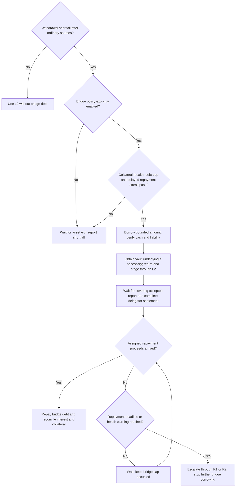

**Support:** possible with borrowing and funding primitives, but requires a dedicated recipe, liability-aware NAV and coordination. Prefer same-token borrowing; any CoW conversion introduces a further delay. Keep disabled until report timing, stressed redemption delay and emergency repayment capacity are validated together.

## Recommended delivery order

1. **Cash and settlement:** L1–L3, U1–U3, Y1 and R3. These give every later strategy funding, claims, conversion and a withdrawal exit.
2. **Debt protection:** R1–R2 and U4, including idle-cash repayment, issuer-specific claim tracking and an emergency path independent of ordinary keeper scheduling.
3. **Unleveraged opportunities:** Y3–Y5, with LL producer compatibility and 3F request selection resolved. Bound inventory, issuer exposure and pending settlement amounts.
4. **Allocation management:** Y2, R4–R5 and the shared priority/reservation coordinator.
5. **Optional risk:** Y6, E1 and E2 only after their settlement and recovery dependencies exist.

Before exposing a strategy as an enabled preset, give it one persisted identity and explicit states such as `idle`, `prepared`, `submitted`, `requested`, `claimable`, `settled`, `expired` and `error`, as applicable. Persist exact order/request/epoch identifiers, account ownership, reserved inputs, expected output token, observed proceeds and deadlines. These are proposed business-level states; they are not all existing keeper job states. Polling/restarts must reconcile old work before creating new obligations.

For acceptance, exercise no-liquidity and partial-capacity paths, stricter health floors, price changes, stale NAV, report staging across batches, duplicate requests, settlement shortfalls, changing claim periods, request ID zero, expiry/cancellation, restarted jobs and simultaneous strategy demand. Verify each enabled issuer's actual NAV and cash lifecycle, including denomination changes. Successful request submission is only the beginning of an asynchronous strategy.

[backend-catalog]: https://github.com/symbioticfi/curator-backend/blob/7b236339329ca0e166df3b6820cc90c2675ef97e/src/domains/merkle/catalog/index.ts
[backend-deployments]: https://github.com/symbioticfi/curator-backend/blob/7b236339329ca0e166df3b6820cc90c2675ef97e/src/domains/merkle/catalog/deployments.ts
[backend-recipes]: https://github.com/symbioticfi/curator-backend/blob/7b236339329ca0e166df3b6820cc90c2675ef97e/src/domains/merkle/recipes/registry.ts
[backend-resolve]: https://github.com/symbioticfi/curator-backend/blob/7b236339329ca0e166df3b6820cc90c2675ef97e/src/domains/merkle/recipes/resolve.ts
[backend-rwas]: https://github.com/symbioticfi/curator-backend/blob/7b236339329ca0e166df3b6820cc90c2675ef97e/docs/MERKLE-RWA-ROUTES.md
[providers]: https://github.com/symbioticfi/merkle-executor/blob/29e16b08f30ff5e8ab05562c369472f161fbbdc4/docs/PROVIDERS.md
[ll-assets]: https://github.com/symbioticfi/merkle-executor/blob/29e16b08f30ff5e8ab05562c369472f161fbbdc4/docs/LIQUID-LANE-ASSETS.md
[securitize-assets]: https://github.com/symbioticfi/merkle-executor/blob/29e16b08f30ff5e8ab05562c369472f161fbbdc4/docs/SECURITIZE-ASSETS.md
