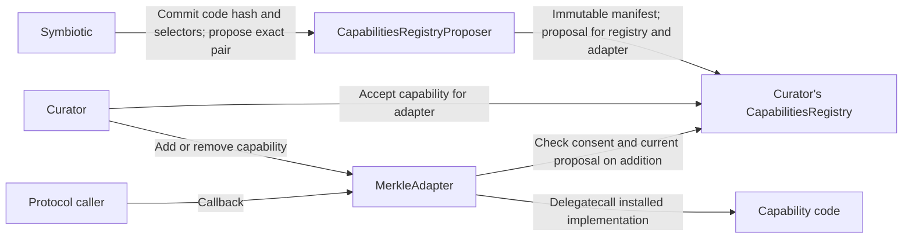

# Capability proposals and curator acceptance

## Chainlink CRE research

Reviewed on September 16, 2026 against Chainlink's official documentation and
`chainlink-evm` revision `593f99abbb70682140d02f2a59bbf1e1a622e1c2`.

| Contract                                                                                                                                                                           | Chainlink responsibility                                                                                                                  | Relevance here                                                                                                                                          |
| ---------------------------------------------------------------------------------------------------------------------------------------------------------------------------------- | ----------------------------------------------------------------------------------------------------------------------------------------- | ------------------------------------------------------------------------------------------------------------------------------------------------------- |
| [CapabilitiesRegistry v2](https://github.com/smartcontractkit/chainlink-evm/blob/593f99abbb70682140d02f2a59bbf1e1a622e1c2/contracts/cre/src/v2/CapabilitiesRegistry.sol#L835-L877) | Owner registers capability IDs, configuration contracts, and metadata, and can deprecate entries. Existing capabilities cannot be edited. | Closest naming and immutable-catalog precedent. Chainlink's capabilities describe DON functionality; ours describe EVM implementations and entrypoints. |
| [WorkflowRegistry v2](https://github.com/smartcontractkit/chainlink-evm/blob/593f99abbb70682140d02f2a59bbf1e1a622e1c2/contracts/cre/src/v2/WorkflowRegistry.sol#L892-L1055)        | Linked workflow owners register workflow IDs, WASM binary/configuration URLs, and execution metadata.                                     | A workflow control plane; it does not store Solidity implementation code or route delegatecalls.                                                        |
| [WorkflowRegistryManager v1](https://github.com/smartcontractkit/chainlink-evm/blob/593f99abbb70682140d02f2a59bbf1e1a622e1c2/contracts/cre/src/v1/WorkflowRegistryManager.sol)     | Owner manages deployed registry versions and selects an active version.                                                                   | Different responsibility from proposing individual capabilities to curators.                                                                            |

CRE's documented deployment flow uploads compiled artifacts to storage and
registers their metadata. The on-chain path uses transactions authorized by the
linked workflow owner. See [deployment](https://docs.chain.link/cre/guides/operations/deploying-workflows)
and [updates](https://docs.chain.link/cre/guides/operations/updating-deployed-workflows).
The sources above do not implement our two-party proposal/acceptance flow.
`CapabilitiesRegistryProposer` is our extension of the capability-catalog naming.
This research is source and documentation review, not verification of deployed
Chainlink registry state.

## Authority and lifecycle

1. **Symbiotic registers code.** `initCapability(implementation, selectors)` on
   the proposer commits deployed runtime bytecode and unique nonzero selectors
   once. New code or selectors require a new address.
2. **Symbiotic proposes use.** `setProposedStatus(registry, adapter,
implementation, true)` identifies one curator registry, adapter, and exact
   implementation. It never changes the curator's acceptance or adapter routes.
3. **The curator accepts.** `acceptCapability(adapter, implementation)` copies
   the immutable manifest into their registry and accepts the exact pair. It
   checks proposal scope and current bytecode. The explicit
   `initCapability`/`setWhitelistedStatus` path provides the same acceptance.
4. **The adapter owner installs.** `addCapability(implementation)` requires
   current proposal status, curator consent, matching code, and selectors not
   assigned to another capability. Native adapter and proxy functions retain dispatch
   precedence. Callers use the adapter address; delegatecall keeps balances and state
   there. No capability factory or implementation migration is required.
5. **Either party can block future installation.** Protocol withdrawal and
   curator revocation leave installed routes active. Removal uses local immutable
   selectors and does not depend on the proposer. Restoring the same proposal
   retains earlier consent unless the curator revoked it; replacements require
   consent for their new address.

## Boundaries

- `BorrowCapability`, `ThreeFCapability`, `CoWSwapCapability`, and
  `LiquidLaneRedeemCapability` use registry-installed implementation code and
  namespaced adapter storage. State-changing operations require `onlyMyself` and
  a Merkle leaf targeting the adapter itself; reads and ERC-1271 validation remain
  public. Token approvals are separate managed calls. `LiquidLaneConnector` keeps
  its separate RWA inventory, factory proxy, and ordinary adapter-call boundary.
- A curator registry can serve multiple adapters. Its proposer is fixed at
  deployment. The Merkle implementation's registry is also fixed; each separate
  curator registry therefore needs its own factory-whitelisted Merkle
  implementation. This keeps the existing implementation trust boundary and
  avoids accepting arbitrary curator-supplied registries during initialization.
- The registry stores the accepted manifest locally, so protocol changes cannot
  rewrite accepted selector lists or change removal behavior.
- Only direct, reviewed implementations fit this model. A runtime code hash does
  not freeze external dependencies or an upgradeable proxy's implementation.
- Delegatecall gives installed code the adapter's full execution context.
  Selector registration does not restrict storage access. Modules must provide
  namespaced storage, caller checks, and their own protocol accounting checks.
- Proposal, acceptance, addition, and removal execute no capability hooks.
  Initialization, obligation settlement, allowance cleanup, and storage
  compatibility remain explicit responsibilities of each integration.

## Verification

Tests exercise separate protocol and curator owners, exact proposal scoping,
immutable manifests, changed runtime code, rollback on rejected acceptance,
curator consent revocation, proposal withdrawal and reproposal, and stateful
governance sequences. Adapter tests execute actual factory proxies and verify
that proposals need consent, dewhitelisted callbacks keep working, removal works
without the proposer, collisions between capabilities revert atomically, and reinstallation
requires current approval.
