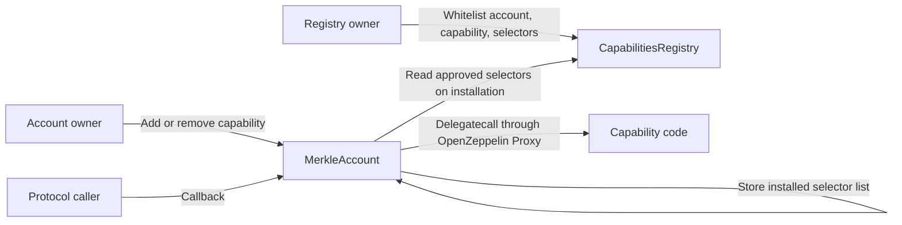

# Capability governance

## Authority and lifecycle

1. The registry owner calls `whitelistCapability(account, capability, signatures)`.
   Every call replaces the complete selector list for that exact pair. A nonempty
   list requires deployed capability code; an empty list revokes installation approval.
2. The account owner calls `addCapability(capability)`. The account reads the
   current list, copies it locally, and installs each route. Empty lists, duplicate
   selectors, and collisions with other capabilities revert the whole addition.
3. Registry changes leave installed routes unchanged. The account owner calls
   `removeCapability(capability)` to clear the installed selectors without reading
   the registry. A missing registry cannot prevent removal.
4. Removal followed by reinstallation adopts the current whitelist. An atomic
   account `multicall` can replace an implementation or its installed selector list.
   Native account functions retain precedence over capability routes.

Both contracts expose selector arrays through public indexed `capabilitySelectors`
getters and `capabilitySelectorsLength`. Registry reads take `(account, capability)`;
account reads take only `(capability)`. Indexed getters append the selector index.

## Boundaries

- `GuardedCallsCapability` is stateless. Its conditions and literal health floors
  are committed by Merkle leaves; changing them requires a new accepted leaf and role.
  3F funding policy lives in a separate `ThreeFPolicy` bound to its executor,
  outside the adapter. Managed operations require an account self-call, a Merkle proof,
  and the caller's leaf role. Reads remain public.
- ERC-1271 is native to the account. `setSignature(domain, signature, hashes)` is an
  authorized self-call that hashes explicit EIP-712 fields and stores an approval
  flag. The leaf fixes the domain, type hash, ABI layout and policy fields.
  Generic byte-range replacements hash nested fields. The leaf also fixes the
  entire hashing program; Liquid Lane uses two replacements for one explicit output
  to the account, while CoW passes an empty program. No protocol-specific code,
  external validator or capability is involved.
  `isValidSignature` reads the approval flag and ignores callback bytes. Protocols
  enforce nonce, expiry and settlement conditions. Revocation uses its own
  `revokeSignature(digest)` leaf; root/role changes preserve approvals.
- Whitelisting controls installation, not individual lending pools. A single
  GuardedCallsCapability supports multiple protocols and conditions through separately approved Merkle leaves.
- The Merkle implementation fixes its capabilities registry at deployment.
  Registry ownership and account ownership remain distinct authorities.
- Only reviewed direct implementations fit this model. Delegatecall gives code the
  account's full storage and execution context; selectors are entrypoints, not a
  storage sandbox. Capability code must authenticate callbacks and preserve protocol
  accounting. Adapter reserves are held separately and never approved to protocol spenders.
- Installation and removal run no capability hooks. They do not clear capability
  storage, cancel orders, revoke token allowances, or settle obligations. Such work
  remains explicit in each integration. LiquidLaneConnector has separate inventory
  and its own factory proxy.

## Verification

Tests cover per-account approval, selector replacement, empty-list revocation,
registry and account owner permissions, collision rollback, native function
precedence, return/revert forwarding, STATICCALL callbacks, and removal after
registry deletion or failure. Registry replacement cannot clear another capability's
routes because removal uses only the account's installed list.

CoW order authorization and revocation are native account self-call leaves.
Token approval requires its own approved leaf. Orders, signatures and relayer
allowances belong to `MerkleAccount`; delayed settlement cannot spend reserves
held by `MerkleAdapter`. CoW needs no settlement hook or capability.
