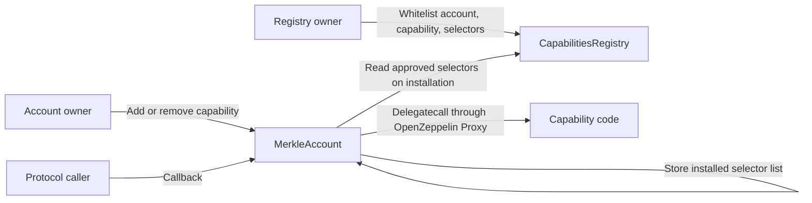

# Capability governance

## Authority and lifecycle

1. The registry owner calls `whitelistCapability(account, capability, signatures)`.
   Every call replaces the complete selector list for that exact pair without checking
   capability code. An empty list revokes installation approval.
2. The account owner calls `addCapability(capability)`. The account reads the
   current list, copies it locally, and installs each route. Empty lists, duplicate
   selectors, and collisions with other capabilities revert the whole addition.
3. Registry changes leave installed routes unchanged. The account owner calls
   `removeCapability(capability)` to clear the installed selectors without reading
   the registry. A missing registry cannot prevent removal.
4. Removal followed by reinstallation adopts the current whitelist. An atomic
   account `multicall` can replace an implementation or its installed selector list.
   Native account functions retain precedence over capability routes.

The registry returns a complete list from `selectors(account, capability)`, so
installation copies it in a single read and assigns it to the account's own list.
The account exposes its installed copy through the indexed `capabilitySelectors(capability, index)`
getter, which reverts past the end; installations themselves are enumerated with `getCapabilities()`.

## Boundaries

- `RecipeCapability` is stateless. Its conditions and literal health floors
  are committed by Merkle leaves; changing them requires a new accepted leaf and role.
  Mutable limits live outside it, in a `ThreeFPolicy` the leaf calls as an ordinary
  guarded call. The leaf fixes which policy, which asset key and which balances are
  observed; the policy owner retunes the budget and minimum ratio without a root update.
  One consumer charges the policy at a time. With the account as consumer, a direct `manage`
  and a `RecipeExecutor` run are both metered by the guarded leaf. Alternatively, the executor
  can be the consumer and charge the policy with `Call`, then validate cash and share deltas
  around a native mint leaf in the same recipe. That mode requires no capability, and the
  native mint leaf role must be restricted to the executor to enforce the policy. The policy is a `MigratableEntity` with its own factory proxy, so its
  address survives implementation upgrades and a migration preserves budgets and usage.
  Its factory ownership is distinct from the account's and the registry's. Managed operations require an account self-call, a Merkle proof,
  and the caller's leaf role. Reads remain public.
- ERC-1271 is native to the account. `sign(domainSeparator, buffer, plan)` is an
  authorized self-call that hashes explicit EIP-712 fields and stores an approval
  flag. The leaf fixes the domain, type hash, ABI layout and policy fields.
  Each step hashes a range of the fixed-length buffer into a destination word, so nested
  fields collapse in place and offsets stay fixed. The leaf also fixes the entire plan;
  Liquid Lane uses two nested steps for one explicit output to the account, while CoW
  needs only the closing whole-buffer step. Every plan ends with that step, whose result
  is the struct hash, so an empty plan is rejected. No protocol-specific code,
  external validator or capability is involved.
  `isValidSignature` reads the approval flag and ignores callback bytes. Protocols
  enforce nonce, expiry and settlement conditions. The account owner calls
  `revokeSignature(digest)` directly, even after clearing the root or leaf roles.
  Root/role changes alone preserve approvals.
- Whitelisting controls installation, not individual lending pools. A single
  RecipeCapability supports multiple protocols and conditions through separately approved Merkle leaves.
- The Merkle implementation fixes its capabilities registry at deployment.
  Registry ownership and account ownership remain distinct authorities.
- Only reviewed direct implementations fit this model. Delegatecall gives code the
  account's full storage and execution context; selectors are entrypoints, not a
  storage sandbox. Capability code must authenticate callbacks and preserve protocol
  accounting. Adapter reserves are held separately and never approved to protocol spenders.
- Installation and removal run no capability hooks. They do not clear capability
  storage, cancel orders, revoke token allowances, or settle obligations. Such work
  remains explicit in each integration. LiquidLaneConnector has separate inventory
  and its own factory proxy.

## Verification

Tests cover per-account approval, selector replacement, empty-list revocation,
registry and account owner permissions, collision rollback, native function
precedence, return/revert forwarding, STATICCALL callbacks, and removal after
registry deletion or failure. Registry replacement cannot clear another capability's
routes because removal uses only the account's installed list.

CoW order authorization uses a native account self-call leaf; the account owner
revokes approved digests directly.
Token approval requires its own approved leaf. Orders, signatures and relayer
allowances belong to `MerkleAccount`; delayed settlement cannot spend reserves
held by `MerkleAdapter`. CoW needs no settlement hook or capability.
