# Base alias for 3F: Merkle whitelist and request runbook (no Safe)

This runbook is for the alias-only flow. The Safe flow is in [RUNBOOK.md](RUNBOOK.md). Keep the Safe flow for chains and
protocols that do not have an alias.

Section 9 lists the scripts and the tests of this flow. Do not use the Safe scripts for this flow. They do not write the
leaves in this runbook.

## 1. Overview

The Ethereum `MerkleAccount` has an address on Base: its alias. The alias is the account address plus
`0x1111000000000000000000000000000000001111`. Some people call it the "virtual account". Use `BaseChain.l2Alias` to get
it.

The alias has no code and no private key. Only a portal deposit from the `MerkleAccount` can make the alias send a call.
Thus, the Ethereum root controls all actions of the alias.

In this flow, the alias is the 3F maker. The alias holds the USDC, the PT and the YT on Base. There is no Safe and no
`RecipeCapability`.

| Contract             | Chain    | Function                                                                                       |
| -------------------- | -------- | ---------------------------------------------------------------------------------------------- |
| `MerkleAccount`      | Ethereum | Sends each Base call as one portal deposit.                                                    |
| `RecipeExecutor`     | Ethereum | Runs the committed mint recipe. It gives the same request and amounts to the four mint leaves. |
| `ThreeFPolicy`       | Base     | Sets a budget for each time window and a minimum yield. Only the alias can call the policy.    |
| Alias of the account | Base     | The 3F maker. It calls the policy, USDC, the 3F request and CCTP.                              |

A Base action goes through these steps:

1. An executor calls `MerkleAccount.manage` on Ethereum, directly or through `RecipeExecutor`.
2. The `MerkleAccount` calls `OptimismPortal.depositTransaction` one time for each Base call. The gas limit of each
   deposit is 1,000,000.
3. Base runs each deposit as one transaction from the alias. Base runs the deposits of one Ethereum transaction in their
   order, in one Base block. This takes approximately 3 minutes.

USDC moves on Circle CCTP v2 Standard Transfer. This transfer has no fee. The CCTP recipient on Base is the alias.

3F enrolls the alias manually. Thus, this flow does not need the `EnrollMaker` signature or the message leaf.

### 1.1 The most important difference from the Safe flow

Each deposit is a separate Base transaction. If one deposit fails, the next deposits still run. Nothing on Base can join
two calls into one transaction for the alias.

| Item                         | Safe flow                                               | Alias flow                                                     |
| ---------------------------- | ------------------------------------------------------- | -------------------------------------------------------------- |
| Contracts on Base            | Safe, `RecipeCapability`, `ThreeFPolicy`                | `ThreeFPolicy` only                                            |
| 3F maker                     | Safe                                                    | Alias                                                          |
| Enrollment                   | `EnrollMaker` signature through a message leaf          | 3F enrolls the alias manually                                  |
| Policy check before the mint | Yes. If `consume` fails, the mint does not occur.       | No. If `consume` fails, `approve` and `mint` still run.        |
| Amounts of the mint          | Read from `mintAuthorization(safe)` on Base             | Supplied by the bot. The bot reads `mintAuthorization(alias)`. |
| Request check                | On Base, before the approval                            | Only off-chain, by the bot                                     |
| Result check                 | The recipe checks the USDC balance and reverts on error | The monitor examines each Base receipt                         |

Thus, in the alias flow, the policy records the budget, but it does not stop a mint. The mint bot is a trusted role.
Refer to section 3.

CAUTION: BEFORE YOU MIGRATE THE ETHEREUM `MerkleAccount`, MOVE ALL USDC, PT AND YT AWAY FROM THE OLD ALIAS. A NEW
ACCOUNT HAS A NEW ALIAS. THE NEW ALIAS IS NOT THE 3F MAKER AND IT IS NOT THE POLICY ACCOUNT. ASK 3F TO ENROLL THE NEW
ALIAS AND CREATE A NEW POLICY FOR IT.

## 2. Merkle root whitelist

The root must contain eleven leaves. Two leaves run on Ethereum. Nine leaves are portal deposits that run on Base.

### 2.1 Ethereum leaves

| Leaf                | Ethereum call                                                                 | Fixed values                                                                | Free values | Give the role to |
| ------------------- | ----------------------------------------------------------------------------- | --------------------------------------------------------------------------- | ----------- | ---------------- |
| `approveBridge`     | USDC `approve(spender, amount)`                                               | spender = CCTP TokenMessengerV2                                             | amount      | executor         |
| `bridgeToBaseAlias` | TokenMessengerV2 `depositForBurn(amount, 6, mintRecipient, USDC, 0, 0, 2000)` | domain 6 (Base), recipient = alias, USDC, all callers, fee 0, finality 2000 | amount      | executor         |

The Safe flow has a `bridgeToBase` leaf with the Safe as the recipient. Do not use it in this flow.

### 2.2 Base leaves

All Base leaves have the same Ethereum target:
`OptimismPortal.depositTransaction(to, value, gasLimit, isCreation, data)`. Each leaf fixes these values:

- `value` = 0
- `gasLimit` = 1,000,000
- `isCreation` = false
- All bytes of `to` and `data`, except the free values in the table.

| Leaf                      | Call that the alias makes on Base (`to` → `data`)                               | Free values                                         | Give the role to           |
| ------------------------- | ------------------------------------------------------------------------------- | --------------------------------------------------- | -------------------------- |
| `setMaxAssetsPerDuration` | policy → `setMaxAssetsPerDuration(USDC, underlyingAsset, maxAssets, duration)`  | underlying asset, budget, time window               | curator                    |
| `setMinYieldPerRequest`   | policy → `setMinYieldPerRequest(underlyingAsset, minimum)`                      | underlying asset, minimum (yield ÷ principal × 1e8) | curator                    |
| `consumeThreeF`           | policy → `consume(request, principal, yield)`                                   | request, principal, yield                           | `RecipeExecutor`           |
| `approveThreeF`           | USDC → `approve(request, principal)`                                            | request, principal                                  | `RecipeExecutor`           |
| `mintThreeF`              | request → `mint(principal, yield)`                                              | `to` (request), principal, yield                    | `RecipeExecutor`           |
| `resetThreeFApproval`     | USDC → `approve(request, 0)`                                                    | request                                             | `RecipeExecutor`, executor |
| `redeemThreeF`            | request → `burnAll(alias, alias)`                                               | `to` (request)                                      | executor                   |
| `approveBurn`             | USDC → `approve(TokenMessengerV2, amount)`                                      | amount                                              | executor                   |
| `bridgeToEthereum`        | TokenMessengerV2 → `depositForBurn(amount, 0, MerkleAccount, USDC, 0, 0, 2000)` | amount                                              | executor                   |

The `resetThreeFApproval` leaf fixes the amount to zero. Thus, it can only remove an approval. The executor uses it
alone to recover after a failed mint (refer to section 6.1).

`ReceiveCctpMessage.s.sol` does not use a leaf. All addresses can call `MessageTransmitterV2.receiveMessage`.

### 2.3 The mint recipe on Ethereum

The four mint leaves have free values. If the executor sets each leaf separately, the leaves can get different requests
or amounts. Thus, give the `consumeThreeF`, `approveThreeF` and `mintThreeF` roles only to `RecipeExecutor`. The
committed recipe gives the same values to all four leaves.

The recipe has three inputs: request, principal and yield. It has these steps:

1. `check(LESS_OR_EQUAL, literal(1), principal)`.
2. `check(LESS_OR_EQUAL, principal, literal(MAX_PRINCIPAL))`. `MAX_PRINCIPAL` is the largest principal for one mint.
3. One `OP_MANAGE` step with gate `literal(1)` and the four leaves in this order: `consumeThreeF`, `approveThreeF`,
   `mintThreeF`, `resetThreeFApproval`.

The bindings write the inputs into the portal calldata. The inner Base call starts at byte 196 of the portal calldata.
Each binding is `offset << 224 | operand`.

| Leaf                  | Request                   | Principal | Yield |
| --------------------- | ------------------------- | --------- | ----- |
| `consumeThreeF`       | 200                       | 232       | 264   |
| `approveThreeF`       | 200                       | 232       | —     |
| `mintThreeF`          | 4 (the portal `to` value) | 200       | 232   |
| `resetThreeFApproval` | 200                       | —         | —     |

The `RecipeExecutor` owner commits the recipe with `setRecipe`. The owner sets the bot with `setCaller`. The owner can
replace the recipe and the caller at any time without a new root (refer to section 3).

NOTE: The recipe cannot read Base. Thus, the recipe cannot check that the request is a 3F request. The recipe can only
make sure that the four calls use the same values and that the principal is in the limits.

### 2.4 Limits on the free values

- **Request:** Only the policy checks the request on Base. The policy refuses an address that the 3F RequestFactory and
  Facility do not know. But a failed `consume` does not stop `approve` and `mint`. Refer to section 3.
- **Principal:** The recipe limits it to `MAX_PRINCIPAL`. The approval gives the request only the principal.
  `resetThreeFApproval` removes the remaining approval after each mint.
- **Yield:** The policy checks the minimum yield. 3F `mint` reverts with `SlippageExceeded` if the authorization does
  not agree with the principal and the yield.
- **Redeem:** The target is free, but the calldata is fixed. `burnAll(alias, alias)` cannot move USDC to a different
  address.
- **Bridge amounts:** The leaves fix the recipients. Thus, a free amount can only move USDC between the `MerkleAccount`
  and the alias.

## 3. Security model

The alias flow has two trusted roles:

- **The caller of `RecipeExecutor` (the mint bot).** It supplies the request, the principal and the yield.
- **The owner of `RecipeExecutor`.** It can commit a different recipe that uses the three mint leaves, and it can change
  the caller. It does not need a new root for these changes. Thus, the owner has the same power over the mint leaves as
  a root change. Use the curator as the owner.

The curator budget and the minimum yield in the policy do not stop a mint in this flow. Only the mint bot enforces them,
before it sends the mint. The mint bot can do these things that the Safe flow prevents:

- **Approval to a contract that is not 3F.** The bot can supply a contract that is not a 3F request. `consume` fails,
  but `approve` and `mint` still run. The contract can then pull the principal from the alias.
- **Mint without the policy.** If `consume` fails for a real request (budget, minimum yield), the mint still occurs. The
  budget does not decrease.
- **Budget charge without a mint.** If `mint` fails or mints nothing, `consume` already decreased the budget. The budget
  comes back at the end of the time window.

The loss is limited by these items:

- The USDC that the alias holds on Base. Bridge only after a won auction, and only the necessary amount.
- `MAX_PRINCIPAL` in the committed recipe. This limit applies to each call. The bot can call the recipe again.
- Only `RecipeExecutor` has the `consumeThreeF`, `approveThreeF` and `mintThreeF` roles. Only the caller of
  `RecipeExecutor` can run the recipe.

Do these steps to decrease the risk:

1. Keep the USDC balance of the alias as low as possible. Bridge back unused USDC after each redeem.
2. Before each mint, simulate the four calls on Base as one bundle from the alias, for example with `eth_simulateV1`. Do
   not send the mint if one call fails. A failed `consume` in the simulation means that the budget or the minimum yield
   does not permit the mint.
3. Set an alert for each failed deposit transaction from the alias (refer to section 7).

NOTE: There is a stronger option: an approval leaf for each won auction, with a fixed request and a fixed principal. For
this option, do all of these steps. If you only add a leaf, the `approveThreeF` leaf with a free spender stays in the
root:

1. Remove the `approveThreeF` leaf from the root.
2. For each won auction, add a leaf with `approve(request, principal)` fixed.
3. Commit a recipe that uses this fixed leaf. Or send the four deposits without a recipe.
4. Tell the curator to accept the root in the 2-hour mint window.

This runbook does not use this option.

## 4. Items that are not in the root

- **A signature leaf.** The alias is not a contract. It cannot sign an ERC-1271 message. 3F enrolls the alias manually.
  Thus, the root does not need a signature leaf.
- **A direct `transfer` on Base.** USDC can only go out of the alias through these paths:
  - The approval and the mint to a request (section 2.3).
  - The CCTP burn to the Ethereum `MerkleAccount`.
- **A `migrate` call on the policy.** The alias owns the policy. A migration needs a new leaf in a new root.

## 5. One-time onboarding

### 5.1 Our contracts

1. Deploy the policy on Base with `DeployBaseAliasPolicy.s.sol`:

   1. Do a dry run without `--broadcast`. The dry run does not write the manifest.
   2. Do the run again with `--broadcast`. The script writes `deployments/base-alias.json`.

   The script does these steps:

   1. Deploys a `MigratablesFactory` and the `ThreeFPolicy` implementation with the 3F RequestFactory and Facility on
      Base.
   2. Creates the policy with `create(lastVersion, alias, abi.encode(alias))`. The alias is the owner and the account.
   3. Gives the factory to the factories owner.
   4. Makes sure that `account()` is the alias.

2. Build the mint recipe with `BuildBaseAliasMintRecipe.s.sol`. Set `BASE_ALIAS_MAX_PRINCIPAL`. The output file has the
   recipe, its hash, the four mint leaves and the calldata of each owner transaction.
3. Deploy `RecipeExecutor` on Ethereum. Send `factoryCreateCalldata` from the output file to the RecipeExecutor factory.
   The constructor arguments are the owner and the `MerkleAccount`. Use the curator as the owner (refer to section 3).
4. Publish the root:
   1. Run `BuildBaseAliasLeaves.s.sol`.
   2. Add the eleven leaves to the `MerkleAccount` tree.
   3. Publish the root in `RootRegistry`.
   4. Tell the curator to call `acceptRoot`.
   5. Give the role of each leaf as the tables in section 2 show. Give the `consumeThreeF`, `approveThreeF` and
      `mintThreeF` roles to the new `RecipeExecutor` only.
   6. Write the proofs file.
5. Tell the executor owner to send `setRecipeCalldata` and `setCallerCalldata` from the output file to the executor.
6. Set the policy limits from Ethereum. Use `SetThreeFMaxAssetsFromAlias` and `SetThreeFMinYieldFromAlias`.

CAUTION: SET A BUDGET BEFORE THE FIRST MINT. IF THERE IS NO BUDGET, `consume` FAILS, BUT THE MINT STILL RUNS.

### 5.2 3F enrollment

Use the Base API at `https://bf.3f.xyz/v2/chains/8453`. This base URL replaces `/v1`. For example, use
`https://bf.3f.xyz/v2/chains/8453/offer`. Do not use `https://bf.3f.xyz/v2/chains/8453/v1/offer`, because it returns
`404`. The paths in this runbook are relative to the base URL.

1. Send the EOA address of the offer bot to 3F for the whitelist. The bot signs API requests. The bot does not hold
   funds.
2. Get a Base API key:
   1. Tell the bot to sign the EIP-712 message `GenerateFacilitatorApiKey { facilitator, deadline }`. Use the domain
      `grunt-api`, version `1` and chain 8453.
   2. Send the signature to `POST /facilitator/generate-key`.
3. Send the alias address to 3F. 3F enrolls the alias as the maker of the bot.
4. Make sure that `GET /facilitator/makers` shows the exact alias address with `isDefault` = `true` and
   `submissionsEnabled` = `true`.
5. Make sure that `GET /facilitator/offer-address` returns the alias. If it does not, set it with
   `POST /facilitator/offer-address`.

CAUTION: SEND THE ALIAS ADDRESS, NOT THE `MerkleAccount` ADDRESS. THE `MerkleAccount` ADDRESS HAS NO FUNDS ON BASE.

## 6. Procedure for each request

Bridge USDC to Base only after the alias wins an auction. The mint window on Base is 2 hours from the auction
acceptance. The bridge and the mint usually take approximately 25 minutes.

```mermaid
flowchart LR
    offer["Send offer<br/>3F API · API key"] --> auth["authorizeMinting<br/>3F calls it on Base"]
    auth -- AWAITING_MINT --> enough{"Sufficient USDC<br/>in the alias?"}
    enough -- no --> bridge["bridgeToBaseAlias<br/>Ethereum · CCTP burn"]
    bridge -- "Iris complete, 15–20 min" --> receive["ReceiveCctpMessage<br/>Base · all addresses can relay"]
    receive --> sim
    enough -- yes --> sim["Simulate the 4 calls<br/>Base · from the alias"]
    sim --> mint["RecipeExecutor.execute<br/>Ethereum · 4 deposits"]
    mint -- "portal, approximately 3 min" --> minted["consume → approve → mint → approve(0)<br/>Base · 4 transactions"]
    minted --> done["Offer SUCCEEDED<br/>3F API · alias holds PT + YT"]
```

1. Calculate the maximum offer before you send it:
   1. Add the USDC balance of the alias on Base and the USDC balance of the Ethereum `MerkleAccount`.
   2. Get the policy budget with `remainingAssets(USDC, underlying)`.
   3. Subtract the principal of all open offers from the two values. An open offer is submitted, accepted or in
      `AWAITING_MINT`, but not minted.
   4. Get the capacity for this request: `MAX_PRINCIPAL` minus the principal of all open offers for the same request. 3F
      can combine all accepted offers of the alias for one request into one authorization. One recipe call must mint
      this total.
   5. Use the smallest of the three values as the maximum offer.
2. Send the offer with `POST /offer` and the `x-api-key` header. Do not send `executionMode`, `chainId` or a signature.
   3F uses the alias as the maker, because the alias is the default address.
3. Monitor the offer with `GET /offer?maker=<bot address>` and the `x-api-key` header. The response includes the offers
   of the alias. When 3F calls `authorizeMinting` on Base, the status changes to `AWAITING_MINT`. Read `mintDeadline`
   from the API.
4. Call `mintAuthorization(alias)` on the request on Base. This is the total authorization. Use its principal and yield
   as the recipe inputs:

   1. Add `pendingAmount` of all offers of the alias for this request in `AWAITING_MINT`. Make sure that the principal
      is equal to this sum. Do not compare it with one offer.
   2. Make sure that the principal is not more than `MAX_PRINCIPAL`. If it is more, stop and tell the curator.

   NOTE: A partial fill can open a new mint window for the same offer. Do steps 4 to 6 again for each window.

5. If the alias does not have sufficient USDC, bridge the difference immediately:
   1. Run `BridgeUsdcToBaseAlias` on Ethereum.
   2. Wait until Iris shows `complete`. This takes approximately 15 to 20 minutes.
   3. Run `ReceiveCctpMessage` on Base.
6. Mint:
   1. Make sure that `RequestFactory.isRequest(request)` on Base returns `true`.
   2. Simulate the four calls on Base as one bundle from the alias. All four calls must succeed.
   3. Run `MintThreeFFromAlias` on Ethereum with the executor, `MAX_PRINCIPAL`, the request, the principal and the
      yield. The script stops if the executor does not hold the recipe for `MAX_PRINCIPAL`.
   4. Wait approximately 3 minutes. Get the four Base transaction hashes from the Ethereum receipt.
   5. Make sure that all four Base transactions succeeded.
   6. Make sure that the `mint` receipt contains the PT `Deposit` event of the request. The sender and the owner must be
      the alias. 3F credits the mint only from this event.
   7. Make sure that the offer status is `SUCCEEDED`.
7. Redeem after the repayment:

   1. Monitor the auction with `GET /auction/{id}`. Wait until the auction status is `REPAID`. You can also use
      `GET /auction?scope=all`.

      NOTE: `GET /auction` without `scope` only returns active auctions. It does not return `REPAID` auctions.

   2. Make sure that `canWithdraw()` on the request returns `true`.
   3. Run `RedeemThreeFFromAlias` with the request. The alias receives the principal and the yield in USDC.
   4. Make sure that `balancesOf(alias)` on the request returns zero PT and zero YT.

8. Move unused USDC back to Ethereum:
   1. Run `BridgeUsdcFromBaseAlias`. It sends the `approveBurn` and `bridgeToEthereum` deposits in one `manage` call.
   2. Wait until Iris shows `complete` for source domain 6.
   3. Run `ReceiveCctpMessage` on Ethereum.

CAUTION: MINT BEFORE `mintDeadline`. IF THE MINT IS NOT COMPLETE 90 MINUTES AFTER THE AUCTION ACCEPTANCE, FIND THE CAUSE
IMMEDIATELY.

### 6.1 Recovery after a failed mint deposit

You cannot retry a deposit that failed on Base. Before you send a new transaction, examine these items:

- The receipt of each of the four Base transactions.
- The PT `Deposit` event of the request in the `mint` receipt.
- The live `mintAuthorization(alias)` on the request.
- `USDC.allowance(alias, request)`.
- `remainingAssets(USDC, underlying)` on the policy.

| Failed deposit                              | Result on Base                                                 | Recovery                                                                                                                                                                                     |
| ------------------------------------------- | -------------------------------------------------------------- | -------------------------------------------------------------------------------------------------------------------------------------------------------------------------------------------- |
| `consume` only                              | The mint occurred. The budget did not decrease.                | Treat it as an incident. Find why the simulation did not stop the mint. Tell the curator. Do not send the mint again.                                                                        |
| `approve` or `mint` (or no `Deposit` event) | The budget decreased. No PT. The reset removed the approval.   | Find the cause. If the authorization is still live and the mint window is open, send a new `MintThreeFFromAlias` call. It charges the budget again. Make sure that the budget is sufficient. |
| `resetThreeFApproval` only                  | The mint occurred. An approval can stay if `mint` pulled less. | Read the allowance. If it is not zero, run `ResetThreeFApprovalFromAlias` with the request. Do not run the full mint again.                                                                  |

CAUTION: DO NOT SEND THE FULL MINT AGAIN ONLY TO REMOVE AN APPROVAL. EACH MINT CALL CHARGES THE BUDGET.

## 7. Monitoring

There are no Safe events in this flow. Each deposit is its own Base transaction. Examine the status of each one.

| Item                        | Where to look                                                                                                                                        | Complete when                                                              |
| --------------------------- | ---------------------------------------------------------------------------------------------------------------------------------------------------- | -------------------------------------------------------------------------- |
| USDC burn, Ethereum → Base  | `GET https://iris-api.circle.com/v2/messages/0?transactionHash=<burnTx>`                                                                             | `status` is `complete`. The response contains `message` and `attestation`. |
| USDC mint on Base           | Run `ReceiveCctpMessage.s.sol` on Base with `message` and `attestation`.                                                                             | The USDC balance of the alias increases.                                   |
| USDC burn, Base → Ethereum  | `GET https://iris-api.circle.com/v2/messages/6?transactionHash=<burnTx>`                                                                             | `status` is `complete`. Then relay the message on Ethereum.                |
| Portal deposits to Base     | One `TransactionDeposited(from = alias, to, …)` log for each deposit. Use viem `getL2TransactionHashes` to get the Base transaction hashes in order. | Each Base transaction exists.                                              |
| Result of each Base call    | The `status` of each Base receipt.                                                                                                                   | All receipts have `status` 1.                                              |
| 3F mint credit              | The PT `Deposit` event of the request in the `mint` receipt.                                                                                         | The sender and the owner are the alias.                                    |
| 3F offer and auction status | `GET /offer?maker=<bot address>` and `GET /auction/{id}` on the 3F API, then `canWithdraw()` on the request.                                         | `SUCCEEDED`, then `REPAID` and `canWithdraw()` returns `true`.             |

Set these alerts:

- An alert for each Base transaction from the alias with `status` 0. Treat a failed `consume` followed by a successful
  `mint` as an incident.
- An alert for each USDC `Approval` from the alias to an address that the 3F RequestFactory does not know.
- An alert for each USDC `Transfer` out of the alias to an address that is not a 3F request or TokenMessengerV2.
- An alert for each burn that does not show `complete` in Iris after 30 minutes.
- An alert for each offer that is in `AWAITING_MINT` status 90 minutes after the auction acceptance.

## 8. Arbitrum and other OP Stack chains

- **OP Stack chains:** Use the same flow. Change the portal, the chain ID, the CCTP domain and the 3F addresses.
- **Arbitrum chains:** Arbitrum also uses the alias offset. Use `Inbox.createRetryableTicket` in place of the portal.
  These items are different:
  - The `MerkleAccount` must pay the L2 gas in ETH on Ethereum. Fix the refund addresses in the leaf.
  - All addresses can redeem a failed retryable ticket for 7 days. Thus, a failed call can run later and out of order.
    Do not let a failed `approve` stay open. Cancel it, or make sure that it cannot succeed later.

This runbook does not give the Arbitrum leaves. Design them before you use an Arbitrum chain.

## 9. Scripts and tests

The Safe scripts stay as they are. Run the action scripts on Ethereum. Set the constants at the top of each action
script before you run it. The action scripts read `deployments/base-alias.json` and
`deployments/base-alias-proofs.json`.

| File                                                           | Function                                                                                                                                                                               |
| -------------------------------------------------------------- | -------------------------------------------------------------------------------------------------------------------------------------------------------------------------------------- |
| `script/base-chain/BaseAliasPayloads.sol`                      | Builds the eleven leaves, the mint recipe (section 2.3) and the recipe inputs.                                                                                                         |
| `script/deploy/base-chain/DeployBaseAliasPolicy.s.sol`         | Base. Deploys the policy for the alias. Reads `BASE_ALIAS_MANIFEST`, `BASE_ETHEREUM_ACCOUNT` and `BASE_FACTORIES_OWNER`.                                                               |
| `script/actions/base-alias/BuildBaseAliasLeaves.s.sol`         | Writes the target, the calldata template, the mask and the hash of each leaf. Reads `BASE_ALIAS_MANIFEST` and `BASE_ALIAS_LEAVES`.                                                     |
| `script/actions/base-alias/BuildBaseAliasMintRecipe.s.sol`     | Writes the mint recipe and the owner calldata. Reads `BASE_ALIAS_MANIFEST`, `BASE_ALIAS_MAX_PRINCIPAL`, `BASE_ALIAS_RECIPE_OWNER`, `BASE_ALIAS_RECIPE_CALLER` and `BASE_ALIAS_RECIPE`. |
| `script/actions/base-alias/SetThreeFMaxAssetsFromAlias.s.sol`  | Sends the `setMaxAssetsPerDuration` deposit.                                                                                                                                           |
| `script/actions/base-alias/SetThreeFMinYieldFromAlias.s.sol`   | Sends the `setMinYieldPerRequest` deposit.                                                                                                                                             |
| `script/actions/base-alias/BridgeUsdcToBaseAlias.s.sol`        | Sends `approveBridge` and `bridgeToBaseAlias` on Ethereum.                                                                                                                             |
| `script/actions/base-alias/MintThreeFFromAlias.s.sol`          | Calls `RecipeExecutor.execute`. The executor sends the four mint deposits.                                                                                                             |
| `script/actions/base-alias/ResetThreeFApprovalFromAlias.s.sol` | Sends the `resetThreeFApproval` deposit alone (section 6.1).                                                                                                                           |
| `script/actions/base-alias/RedeemThreeFFromAlias.s.sol`        | Sends the `redeemThreeF` deposit.                                                                                                                                                      |
| `script/actions/base-alias/BridgeUsdcFromBaseAlias.s.sol`      | Sends the `approveBurn` and `bridgeToEthereum` deposits.                                                                                                                               |
| `script/actions/base-chain/ReceiveCctpMessage.s.sol`           | Relays an attested CCTP message on Base or on Ethereum. Both flows use it.                                                                                                             |
| `test/deploy/BaseAliasPayloads.t.sol`                          | Unit tests: leaves, masks, recipe bindings, recipe limits and proof files.                                                                                                             |
| `test/deploy/DeployBaseAlias.t.sol`                            | Base fork tests for the deploy and each deposit, which includes the failures in section 3. Ethereum fork tests for the portal and CCTP.                                                |

NOTE: The fork tests use `BASE_RPC_URL` and `ETH_RPC_URL`. If a variable is not set, the tests in that group are
skipped.

## 10. Open questions

- [ ] **Late mint (3F):** What does the "timeout and revocation flow" do to a maker that mints too late?
- [ ] **Per-request approval (Symbiotic):** Is the risk in section 3 acceptable? If not, use the per-request approval
      leaf.
