# Base alias for 3F: Merkle whitelist and request runbook (no Safe)

This runbook is for the alias-only flow. The Safe flow is in [RUNBOOK.md](RUNBOOK.md). Keep the Safe flow for chains and
protocols that do not have an alias.

Section 9 lists the scripts and the tests of this flow. Do not use the Safe scripts for this flow. They do not write the
leaves in this runbook.

## 1. Overview

The Ethereum `MerkleAccount` has an address on Base: its alias. The alias is the account address plus
`0x1111000000000000000000000000000000001111`. Some people call it the "virtual account". Use `BaseChain.l2Alias` to get
it.

The alias has no code and no private key. Only a portal deposit from the `MerkleAccount` can make the alias send a call.
Thus, the Ethereum root controls all actions of the alias.

In this flow, the alias is the 3F maker. The alias holds the USDC, the PT and the YT on Base. There is no Safe and no
`RecipeCapability`.

| Contract                | Chain    | Function                                                                                                         |
| ----------------------- | -------- | ---------------------------------------------------------------------------------------------------------------- |
| `MerkleAccount`         | Ethereum | Calls the policy directly and sends each Base call as a portal deposit.                                          |
| `RecipeExecutor`        | Ethereum | Runs the committed mint recipe with one request and one set of amounts.                                          |
| `BaseAliasThreeFPolicy` | Ethereum | Enforces the request list, per-collateral dispatch budget and minimum yield. Only the MerkleAccount can call it. |
| Alias of the account    | Base     | The 3F maker. It calls USDC, the 3F request and CCTP.                                                            |

A Base action goes through these steps:

1. An executor calls `MerkleAccount.manage` on Ethereum, directly or through `RecipeExecutor`.
2. The `MerkleAccount` calls `OptimismPortal.depositTransaction` one time for each Base call. The gas limit of each
   deposit is 1,000,000.
3. Base runs each deposit as one transaction from the alias. Base runs the deposits of one Ethereum transaction in their
   order, in one Base block. This takes approximately 3 minutes.

USDC moves on Circle CCTP v2 Standard Transfer. This transfer has no fee. The CCTP recipient on Base is the alias.

3F enrolls the alias manually. Thus, this flow does not need the `EnrollMaker` signature or the message leaf.

### 1.1 Mint execution

The Ethereum transaction charges the policy and queues the three Base deposits. If the policy or a portal call reverts
on Ethereum, the budget and any deposits from that transaction revert. After a successful dispatch, Base runs the deposits
as independent transactions from the alias. A Base failure leaves the Ethereum budget charge in place.

Before moving to a new Ethereum MerkleAccount, settle positions and move funds out of the old alias. The new account has a
new alias and needs a new policy and 3F enrollment.

## 2. Merkle root whitelist

The root contains twelve leaves. Six run on Ethereum and six are portal deposits that run on Base.

### 2.1 Ethereum leaves

| Leaf                      | Ethereum call                                                                 | Fixed values                                                                | Free values                                            | Give the role to |
| ------------------------- | ----------------------------------------------------------------------------- | --------------------------------------------------------------------------- | ------------------------------------------------------ | ---------------- |
| `approveBridge`           | USDC `approve(spender, amount)`                                               | spender = CCTP TokenMessengerV2                                             | amount                                                 | executor         |
| `bridgeToBaseAlias`       | TokenMessengerV2 `depositForBurn(amount, 6, mintRecipient, USDC, 0, 0, 2000)` | domain 6 (Base), recipient = alias, USDC, all callers, fee 0, finality 2000 | amount                                                 | executor         |
| `setRequestUnderlying`    | Policy `setRequestUnderlying(request, underlyingAsset)`                       | policy address                                                              | request and Base collateral underlying                 | curator          |
| `setMaxAssetsPerDuration` | Policy `setMaxAssetsPerDuration(underlyingAsset, maxAssets, duration)`        | policy address                                                              | underlying asset, budget and time window               | curator          |
| `setMinYieldPerRequest`   | Policy `setMinYieldPerRequest(underlyingAsset, minimum)`                      | policy address                                                              | underlying asset and minimum (yield ÷ principal × 1e8) | curator          |
| `consumeThreeF`           | Policy `consume(request, principal, yield)`                                   | policy address                                                              | request, principal and yield                           | `RecipeExecutor` |

The Safe flow has a `bridgeToBase` leaf with the Safe as the recipient. Do not use it in this flow.

### 2.2 Base leaves

All Base leaves have the same Ethereum target:
`OptimismPortal.depositTransaction(to, value, gasLimit, isCreation, data)`. Each leaf fixes these values:

- `value` = 0
- `gasLimit` = 1,000,000
- `isCreation` = false
- All bytes of `to` and `data`, except the free values in the table.

| Leaf                  | Call that the alias makes on Base (`to` → `data`)                               | Free values                      | Give the role to           |
| --------------------- | ------------------------------------------------------------------------------- | -------------------------------- | -------------------------- |
| `approveThreeF`       | USDC → `approve(request, principal)`                                            | request, principal               | `RecipeExecutor`           |
| `mintThreeF`          | request → `mint(principal, yield)`                                              | `to` (request), principal, yield | `RecipeExecutor`           |
| `resetThreeFApproval` | USDC → `approve(request, 0)`                                                    | request                          | `RecipeExecutor`, executor |
| `redeemThreeF`        | request → `burnAll(alias, alias)`                                               | `to` (request)                   | executor                   |
| `approveBurn`         | USDC → `approve(TokenMessengerV2, amount)`                                      | amount                           | executor                   |
| `bridgeToEthereum`    | TokenMessengerV2 → `depositForBurn(amount, 0, MerkleAccount, USDC, 0, 0, 2000)` | amount                           | executor                   |

The `resetThreeFApproval` leaf fixes the amount to zero. Thus, it can only remove an approval. The executor uses it
alone to recover after a failed mint (refer to section 6.1).

`ReceiveCctpMessage.s.sol` does not use a leaf. All addresses can call `MessageTransmitterV2.receiveMessage`.

### 2.3 The mint recipe on Ethereum

The four mint leaves have free values. If the executor sets each leaf separately, the leaves can get different requests
or amounts. Thus, give the `consumeThreeF`, `approveThreeF` and `mintThreeF` roles only to `RecipeExecutor`. The
committed recipe gives the same values to all four leaves.

The recipe requires a nonzero principal within `MAX_PRINCIPAL` and both mint amounts to fit `uint128`. It then calls
`MerkleAccount.manage` once with Ethereum `consumeThreeF` and the Base deposits for `approveThreeF`, `mintThreeF` and
`resetThreeFApproval`, in that order.

The policy uses direct calldata. Each portal action carries its Base call starting at byte 196. Each binding is
`offset << 224 | operand`.

| Leaf                  | Request                   | Principal | Yield |
| --------------------- | ------------------------- | --------- | ----- |
| `consumeThreeF`       | 4                         | 36        | 68    |
| `approveThreeF`       | 200                       | 232       | —     |
| `mintThreeF`          | 4 (the portal `to` value) | 200       | 232   |
| `resetThreeFApproval` | 200                       | —         | —     |

The policy charges the same principal cap that the recipe approves and passes to Base `mint`. The policy checks the
same minimum yield passed to Base `mint`. The request reads the live authorization on Base and applies those bounds.

## 3. Security model

- Before registering a request, the curator checks `RequestFactory.isRequest(request)` and confirms that
  `request.asset()` is Base USDC. Read the intent ID from `request.name()` (`request-{id}`) and confirm that
  `Facility.getIntent(id)` returns that same request. Use the target asset if it is a position manager, otherwise
  use the deposit asset if it is a position manager. Read its collateral from `assets()`, then call `underlying()`
  on the collateral token. Register that Base address as the budget key on Ethereum.
- Keep the registry current. The policy rejects unregistered requests. Set the underlying to the zero address to
  revoke a registration for future dispatches.
- The curator owns the RecipeExecutor. Its owner can replace the recipe and caller without a root change. Give the
  `consumeThreeF`, `approveThreeF` and `mintThreeF` roles only to the executor with the committed mint recipe.
- The mint bot supplies the request and amounts. The Ethereum budget limits cumulative dispatch during each window.
  Each successful dispatch charges the principal cap, even if the Base mint later fails, mints nothing, or pulls less.
- Before dispatching, simulate the Ethereum recipe, then simulate the three Base calls as a bundle from the alias.
  The Ethereum simulation checks policy admission. The Base simulation checks execution against the current authorization,
  balance and allowances.

## 4. Items that are not in the root

- **A signature leaf.** The alias is not a contract. It cannot sign an ERC-1271 message. 3F enrolls the alias manually.
  Thus, the root does not need a signature leaf.
- **A direct `transfer` on Base.** USDC can only go out of the alias through these paths:
  - The approval and the mint to a request (section 2.3).
  - The CCTP burn to the Ethereum `MerkleAccount`.

## 5. One-time onboarding

### 5.1 Our contracts

1. Deploy the policy on Ethereum with `DeployBaseAliasPolicy.s.sol`. Set `BASE_ETHEREUM_ACCOUNT` to the Ethereum
   MerkleAccount and `BASE_ALIAS_MANIFEST` to `deployments/base-alias.json`. Run the script against `ETH_RPC_URL`
   using the deployer account. A dry run leaves the manifest unwritten. Add `--broadcast` to deploy and write it.
2. Run `BuildBaseAliasMintRecipe.s.sol`. Set `BASE_ALIAS_MAX_PRINCIPAL` to the cap per mint. The output includes the
   recipe, its hash, the four mint leaves and the calldata for installing the recipe.
3. Deploy the `RecipeExecutor` on Ethereum using the generated `factoryCreateCalldata`. Set the curator as the owner.
4. Run `BuildBaseAliasLeaves.s.sol` and publish the twelve leaves in the Ethereum MerkleAccount tree. Accept the root,
   grant the roles listed in section 2, and write the proofs file. An existing alias setup needs a fresh manifest, recipe,
   root and proofs. Retire the old mint executor's raw approval and mint grants when switching.
5. Have the executor owner send the generated `setRecipeCalldata` and `setCallerCalldata`.
6. Configure the Ethereum policy budget and minimum yield for each supported Base collateral underlying through
   `SetThreeFMaxAssetsFromAlias` and `SetThreeFMinYieldFromAlias`. For each Base request, use
   `SetThreeFRequestUnderlyingFromAlias` after verifying it as described in section 3. Pass the request and underlying
   with `--sig "run(address,address)" <request> <underlying>`.

### 5.2 3F enrollment

Use the Base API at `https://bf.3f.xyz/v2/chains/8453`. This base URL replaces `/v1`. For example, use
`https://bf.3f.xyz/v2/chains/8453/offer`. Do not use `https://bf.3f.xyz/v2/chains/8453/v1/offer`, because it returns
`404`. The paths in this runbook are relative to the base URL.

1. Send the EOA address of the offer bot to 3F for the whitelist. The bot signs API requests. The bot does not hold
   funds.
2. Get a Base API key:
   1. Tell the bot to sign the EIP-712 message `GenerateFacilitatorApiKey { facilitator, deadline }`. Use the domain
      `grunt-api`, version `1` and chain 8453.
   2. Send the signature to `POST /facilitator/generate-key`.
3. Send the alias address to 3F. 3F enrolls the alias as the maker of the bot.
4. Make sure that `GET /facilitator/makers` shows the exact alias address with `isDefault` = `true` and
   `submissionsEnabled` = `true`.
5. Make sure that `GET /facilitator/offer-address` returns the alias. If it does not, set it with
   `POST /facilitator/offer-address`.

CAUTION: SEND THE ALIAS ADDRESS, NOT THE `MerkleAccount` ADDRESS. THE `MerkleAccount` ADDRESS HAS NO FUNDS ON BASE.

## 6. Procedure for each request

Bridge USDC to Base only after the alias wins an auction. The mint window on Base is 2 hours from the auction
acceptance. The bridge and the mint usually take approximately 25 minutes.

```mermaid
flowchart LR
    offer["Send offer<br/>3F API · API key"] --> auth["authorizeMinting<br/>3F calls it on Base"]
    auth -- AWAITING_MINT --> enough{"Sufficient USDC<br/>in the alias?"}
    enough -- no --> bridge["bridgeToBaseAlias<br/>Ethereum · CCTP burn"]
    bridge -- "Iris complete, 15–20 min" --> receive["ReceiveCctpMessage<br/>Base · all addresses can relay"]
    receive --> sim
    enough -- yes --> sim["Simulate policy on Ethereum<br/>and the three Base calls from the alias"]
    sim --> mint["RecipeExecutor.execute<br/>Ethereum · consume + 3 deposits"]
    mint -- "portal, approximately 3 min" --> minted["approve → mint → approve(0)<br/>Base · 3 transactions"]
    minted --> done["Offer SUCCEEDED<br/>3F API · alias holds PT + YT"]
```

1. Calculate the maximum offer before you send it:
   1. Add the USDC balance of the alias on Base and the USDC balance of the Ethereum `MerkleAccount`.
   2. Read the Ethereum policy budget with `remainingAssets(underlying)`.
   3. Subtract the principal of all open offers from the two values. An open offer is submitted, accepted or in
      `AWAITING_MINT`, but not minted.
   4. Get the capacity for this request: `MAX_PRINCIPAL` minus the principal of all open offers for the same request. 3F
      can combine all accepted offers of the alias for one request into one authorization. One recipe call must mint
      this total.
   5. Use the smallest of the three values as the maximum offer.
2. Send the offer with `POST /offer` and the `x-api-key` header. Do not send `executionMode`, `chainId` or a signature.
   3F uses the alias as the maker, because the alias is the default address.
3. Monitor the offer with `GET /offer?maker=<bot address>` and the `x-api-key` header. The response includes the offers
   of the alias. When 3F calls `authorizeMinting` on Base, the status changes to `AWAITING_MINT`. Read `mintDeadline`
   from the API.
4. Call `mintAuthorization(alias)` on the request on Base. This is the total authorization. Use its principal and yield
   as the recipe inputs:

   1. Add `pendingAmount` of all offers of the alias for this request in `AWAITING_MINT`. Make sure that the principal
      is equal to this sum. Do not compare it with one offer.
   2. Make sure that the principal is not more than `MAX_PRINCIPAL`. If it is more, stop and tell the curator.

   NOTE: A partial fill can open a new mint window for the same offer. Do steps 4 to 6 again for each window.

5. If the alias does not have sufficient USDC, bridge the difference immediately:
   1. Run `BridgeUsdcToBaseAlias` on Ethereum.
   2. Wait until Iris shows `complete`. This takes approximately 15 to 20 minutes.
   3. Run `ReceiveCctpMessage` on Base.
6. Mint:
   1. Verify the request on Base and check its approved collateral on the Ethereum policy.
   2. Simulate the Ethereum recipe and all three Base calls from the alias.
   3. Run `MintThreeFFromAlias` on Ethereum with the executor, `MAX_PRINCIPAL`, the request, the principal and the
      yield. The script stops if the executor does not hold the recipe for `MAX_PRINCIPAL`.
   4. Wait approximately 3 minutes. Get the three Base transaction hashes from the Ethereum receipt.
   5. Make sure that all three Base transactions succeeded.
   6. Make sure that the `mint` receipt contains the PT `Deposit` event of the request. The sender and the owner must be
      the alias. 3F credits the mint only from this event.
   7. Make sure that the offer status is `SUCCEEDED`.
7. Redeem after the repayment:

   1. Monitor the auction with `GET /auction/{id}`. Wait until the auction status is `REPAID`. You can also use
      `GET /auction?scope=all`.

      NOTE: `GET /auction` without `scope` only returns active auctions. It does not return `REPAID` auctions.

   2. Make sure that `canWithdraw()` on the request returns `true`.
   3. Run `RedeemThreeFFromAlias` with the request. The alias receives the principal and the yield in USDC.
   4. Make sure that `balancesOf(alias)` on the request returns zero PT and zero YT.

8. Move unused USDC back to Ethereum:
   1. Run `BridgeUsdcFromBaseAlias`. It sends the `approveBurn` and `bridgeToEthereum` deposits in one `manage` call.
   2. Wait until Iris shows `complete` for source domain 6.
   3. Run `ReceiveCctpMessage` on Ethereum.

CAUTION: MINT BEFORE `mintDeadline`. IF THE MINT IS NOT COMPLETE 90 MINUTES AFTER THE AUCTION ACCEPTANCE, FIND THE CAUSE
IMMEDIATELY.

### 6.1 Recovery after a failed mint deposit

You cannot retry a deposit that failed on Base. Before you send a new transaction, examine these items:

- The Ethereum dispatch receipt and the receipts of the three Base transactions. A reverted Ethereum dispatch sends zero deposits.
- The PT `Deposit` event of the request in the `mint` receipt.
- The live `mintAuthorization(alias)` on the request.
- `USDC.allowance(alias, request)`.
- `remainingAssets(underlying)` on the policy.

| Failed deposit                              | Result on Base                                                 | Recovery                                                                                                                                                                                     |
| ------------------------------------------- | -------------------------------------------------------------- | -------------------------------------------------------------------------------------------------------------------------------------------------------------------------------------------- |
| `approve` or `mint` (or no `Deposit` event) | The budget decreased. No PT. The reset removed the approval.   | Find the cause. If the authorization is still live and the mint window is open, send a new `MintThreeFFromAlias` call. It charges the budget again. Make sure that the budget is sufficient. |
| `resetThreeFApproval` only                  | The mint occurred. An approval can stay if `mint` pulled less. | Read the allowance. If it is not zero, run `ResetThreeFApprovalFromAlias` with the request. Do not run the full mint again.                                                                  |

CAUTION: DO NOT SEND THE FULL MINT AGAIN ONLY TO REMOVE AN APPROVAL. EACH MINT CALL CHARGES THE BUDGET.

## 7. Monitoring

There are no Safe events in this flow. Each deposit is its own Base transaction. Examine the status of each one.

| Item                        | Where to look                                                                                                                                        | Complete when                                                              |
| --------------------------- | ---------------------------------------------------------------------------------------------------------------------------------------------------- | -------------------------------------------------------------------------- |
| USDC burn, Ethereum → Base  | `GET https://iris-api.circle.com/v2/messages/0?transactionHash=<burnTx>`                                                                             | `status` is `complete`. The response contains `message` and `attestation`. |
| USDC mint on Base           | Run `ReceiveCctpMessage.s.sol` on Base with `message` and `attestation`.                                                                             | The USDC balance of the alias increases.                                   |
| USDC burn, Base → Ethereum  | `GET https://iris-api.circle.com/v2/messages/6?transactionHash=<burnTx>`                                                                             | `status` is `complete`. Then relay the message on Ethereum.                |
| Portal deposits to Base     | One `TransactionDeposited(from = alias, to, …)` log for each deposit. Use viem `getL2TransactionHashes` to get the Base transaction hashes in order. | Each Base transaction exists.                                              |
| Result of each Base call    | The `status` of each Base receipt.                                                                                                                   | All receipts have `status` 1.                                              |
| 3F mint credit              | The PT `Deposit` event of the request in the `mint` receipt.                                                                                         | The sender and the owner are the alias.                                    |
| 3F offer and auction status | `GET /offer?maker=<bot address>` and `GET /auction/{id}` on the 3F API, then `canWithdraw()` on the request.                                         | `SUCCEEDED`, then `REPAID` and `canWithdraw()` returns `true`.             |

Set these alerts:

- An alert for each failed Ethereum dispatch or Base transaction from the alias.
- An alert for each USDC `Approval` from the alias to an address that the 3F RequestFactory does not know.
- An alert for each USDC `Transfer` out of the alias to an address that is not a 3F request or TokenMessengerV2.
- An alert for each burn that does not show `complete` in Iris after 30 minutes.
- An alert for each offer that is in `AWAITING_MINT` status 90 minutes after the auction acceptance.

## 8. Arbitrum and other OP Stack chains

- **OP Stack chains:** Use the same flow. Change the portal, the chain ID, the CCTP domain and the 3F addresses.
- **Arbitrum chains:** Arbitrum also uses the alias offset. Use `Inbox.createRetryableTicket` in place of the portal.
  These items are different:
  - The `MerkleAccount` must pay the L2 gas in ETH on Ethereum. Fix the refund addresses in the leaf.
  - All addresses can redeem a failed retryable ticket for 7 days. Thus, a failed call can run later and out of order.
    Do not let a failed `approve` stay open. Cancel it, or make sure that it cannot succeed later.

This runbook does not give the Arbitrum leaves. Design them before you use an Arbitrum chain.

## 9. Scripts and tests

The Safe scripts stay as they are. Run the action scripts on Ethereum. Set the constants at the top of each action
script before you run it. The action scripts read `deployments/base-alias.json` and
`deployments/base-alias-proofs.json`.

| File                                                                  | Function                                                                                                                                                                               |
| --------------------------------------------------------------------- | -------------------------------------------------------------------------------------------------------------------------------------------------------------------------------------- |
| `script/base-chain/BaseAliasPayloads.sol`                             | Builds the twelve leaves, the mint recipe (section 2.3) and the recipe inputs.                                                                                                         |
| `script/deploy/base-chain/DeployBaseAliasPolicy.s.sol`                | Ethereum. Deploys the policy bound to the MerkleAccount. Reads `BASE_ALIAS_MANIFEST` and `BASE_ETHEREUM_ACCOUNT`.                                                                      |
| `script/actions/base-alias/BuildBaseAliasLeaves.s.sol`                | Writes the target, the calldata template, the mask and the hash of each leaf. Reads `BASE_ALIAS_MANIFEST` and `BASE_ALIAS_LEAVES`.                                                     |
| `script/actions/base-alias/BuildBaseAliasMintRecipe.s.sol`            | Writes the mint recipe and the owner calldata. Reads `BASE_ALIAS_MANIFEST`, `BASE_ALIAS_MAX_PRINCIPAL`, `BASE_ALIAS_RECIPE_OWNER`, `BASE_ALIAS_RECIPE_CALLER` and `BASE_ALIAS_RECIPE`. |
| `script/actions/base-alias/SetThreeFMaxAssetsFromAlias.s.sol`         | Sets the Ethereum policy's collateral budget.                                                                                                                                          |
| `script/actions/base-alias/SetThreeFMinYieldFromAlias.s.sol`          | Sets the Ethereum policy's minimum yield.                                                                                                                                              |
| `script/actions/base-alias/SetThreeFRequestUnderlyingFromAlias.s.sol` | Registers or revokes a request on the Ethereum policy.                                                                                                                                 |
| `script/actions/base-alias/BridgeUsdcToBaseAlias.s.sol`               | Sends `approveBridge` and `bridgeToBaseAlias` on Ethereum.                                                                                                                             |
| `script/actions/base-alias/MintThreeFFromAlias.s.sol`                 | Calls `RecipeExecutor.execute`. The executor charges the policy and sends the three mint deposits.                                                                                     |
| `script/actions/base-alias/ResetThreeFApprovalFromAlias.s.sol`        | Sends the `resetThreeFApproval` deposit alone (section 6.1).                                                                                                                           |
| `script/actions/base-alias/RedeemThreeFFromAlias.s.sol`               | Sends the `redeemThreeF` deposit.                                                                                                                                                      |
| `script/actions/base-alias/BridgeUsdcFromBaseAlias.s.sol`             | Sends the `approveBurn` and `bridgeToEthereum` deposits.                                                                                                                               |
| `script/actions/base-chain/ReceiveCctpMessage.s.sol`                  | Relays an attested CCTP message on Base or on Ethereum. Both flows use it.                                                                                                             |
| `test/deploy/BaseAliasPayloads.t.sol`                                 | Unit tests: leaves, masks, recipe bindings, recipe limits and proof files.                                                                                                             |
| `test/deploy/DeployBaseAlias.t.sol`                                   | Policy deployment and optional fork tests for the portal, mint, redeem and CCTP.                                                                                                       |
| `test/adapters/merkle-adapter/BaseAliasMint.t.sol`                    | Exercises the mint dispatch through the real executor and MerkleAccount in CI.                                                                                                         |

NOTE: The fork tests use `BASE_RPC_URL` and `ETH_RPC_URL`. If a variable is not set, the tests in that group are
skipped.

## 10. Open questions

- [ ] **Late mint (3F):** What does the "timeout and revocation flow" do to a maker that mints too late?
