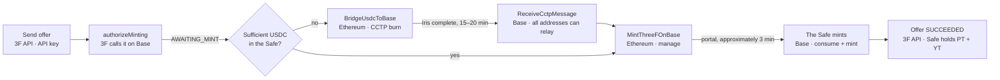

# Base Safe for 3F: Merkle whitelist and request runbook

For the flow without a Safe, where the alias of the `MerkleAccount` is the 3F maker, refer to
[ALIAS_RUNBOOK.md](ALIAS_RUNBOOK.md).

## 1. Overview

The Ethereum `MerkleAccount` root controls all actions on Base. Each Base action starts as a `MerkleAccount.manage` call
on Ethereum.

The Base deployment has three contracts. `DeployBaseSafe.s.sol` deploys them. The deployment does not change the
contract code.

| Base contract          | Function                                                                                   |
| ---------------------- | ------------------------------------------------------------------------------------------ |
| Safe v1.4.1 (`SafeL2`) | Holds the USDC and the 3F positions. The Safe has two modules: the alias and the Safe.     |
| `RecipeCapability`     | Runs recipes. It has no state. The Safe uses a delegatecall to run it.                     |
| `ThreeFPolicy`         | Sets a budget for each time window and a minimum yield. Only the Safe can call the policy. |

A Base action goes through these steps:

1. An executor calls `MerkleAccount.manage` on Ethereum. The executor must have the role of the leaf.
2. The `MerkleAccount` calls `OptimismPortal.depositTransaction` on Ethereum. The target is the Safe. The gas limit is
   1,000,000.
3. Base runs the call after some minutes. The sender on Base is the alias of the `MerkleAccount`. The alias is the
   account address plus `0x1111…1111`. The alias is the only Safe owner and a Safe module.
4. The alias calls the Safe. The Safe does one of these three operations:
   - A direct call. The policy setters use a direct call.
   - A call to itself, which then makes a delegatecall to `RecipeCapability`. The 3F mint, the 3F redeem and the bridge
     to Ethereum use this path.
   - An approval of one message hash with `Safe.approveHash`. The one-time 3F enrollment uses this path.

USDC moves on a different path: Circle CCTP v2 Standard Transfer. This transfer has no fee.

The alias is the only Safe owner. The threshold is 1. No key on Base controls the Safe. Thus, all actions and all admin
changes need a leaf in the Ethereum root. To add an action, add a recipe or a leaf with the usual root procedure.

CAUTION: BEFORE YOU MIGRATE THE ETHEREUM `MerkleAccount`, MOVE THE SAFE TO THE NEW ALIAS. ADD AND RUN A LEAF THAT ADDS
THE NEW ALIAS AS THE OWNER AND THE MODULE. THE LEAF MUST ALSO REMOVE THE OLD ALIAS. IF YOU DO NOT DO THIS, YOU CANNOT
CONTROL THE SAFE.

## 2. Merkle root whitelist

The `MerkleAccount` root must contain seven leaves. Two leaves run on Ethereum. Five leaves run on Base. The 3F
enrollment needs one more leaf one time (refer to section 2.4).

`BuildBaseChainLeaves.s.sol` writes the data for each leaf: the target, the calldata template, the mask and the hash.
The script reads the addresses from the Base manifest.

### 2.1 Ethereum leaves

These leaves call Ethereum contracts directly.

| Leaf            | Ethereum call                                                                                                                           | Fixed values                                                               | Free values | Give the role to |
| --------------- | --------------------------------------------------------------------------------------------------------------------------------------- | -------------------------------------------------------------------------- | ----------- | ---------------- |
| `approveBridge` | USDC `approve(spender, amount)`                                                                                                         | spender = CCTP TokenMessengerV2                                            | amount      | executor         |
| `bridgeToBase`  | TokenMessengerV2 `depositForBurn(amount, destinationDomain, mintRecipient, burnToken, destinationCaller, maxFee, minFinalityThreshold)` | domain 6 (Base), recipient = Safe, USDC, all callers, fee 0, finality 2000 | amount      | executor         |

### 2.2 Base leaves

All Base leaves have the same Ethereum target:
`OptimismPortal.depositTransaction(to, value, gasLimit, isCreation, data)`. Each leaf fixes these values:

- `to` = the Safe
- `value` = 0
- `gasLimit` = 1,000,000
- `isCreation` = false
- All bytes of the Safe call, except the free values in the table.

| Leaf                      | Call that the Safe makes on Base                                                                                                                                                                              | Free values                                         | Give the role to |
| ------------------------- | ------------------------------------------------------------------------------------------------------------------------------------------------------------------------------------------------------------- | --------------------------------------------------- | ---------------- |
| `setMaxAssetsPerDuration` | `ThreeFPolicy.setMaxAssetsPerDuration(USDC, underlyingAsset, maxAssets, duration)`                                                                                                                            | underlying asset, budget, time window               | curator          |
| `setMinYieldPerRequest`   | `ThreeFPolicy.setMinYieldPerRequest(underlyingAsset, minimum)`                                                                                                                                                | underlying asset, minimum (yield ÷ principal × 1e8) | curator          |
| `mintThreeF`              | Recipe: read `mintAuthorization(safe)` → `policy.consume(request, principal, yield)` → USDC `approve(request, principal)` → `request.mint(principal, yield)` → `approve(request, 0)` → check the USDC balance | request, principal limit                            | trusted executor |
| `redeemThreeF`            | Recipe: check `RequestFactory.isRequest(request)` → `request.burnAll(safe, safe)` → check that the Safe has no PT or YT                                                                                       | request                                             | executor         |
| `bridgeToEthereum`        | Recipe: USDC `approve(TokenMessengerV2, amount)` → `depositForBurn` to domain 0, recipient = Ethereum `MerkleAccount`, fee 0, finality 2000                                                                   | amount                                              | executor         |

`ReceiveCctpMessage.s.sol` does not use a leaf. All addresses can call `MessageTransmitterV2.receiveMessage`.

### 2.3 Limits on the free values

- **Request in the 3F recipes:** One recipe input gives the request to all calls in the recipe. The recipe calls the
  request through the Safe, because a recipe call target must be a literal address. The policy refuses an address that
  the 3F RequestFactory and Facility on Base do not know. The redeem recipe refuses an address that the RequestFactory
  does not know.
- **Amounts in `mintThreeF`:** The recipe reads the principal and the yield from `mintAuthorization(safe)` on Base. The
  executor does not supply them. The recipe stops if the principal is zero or more than the principal limit. Thus, a
  stale or cancelled authorization does not decrease the policy budget.
- **Policy in `mintThreeF`:** The policy decreases the budget for the underlying asset of the request. The policy also
  checks the minimum yield.
- **Result of the 3F recipes:** A Safe module call does not revert when it fails. Thus, each 3F recipe checks the
  result. The mint recipe makes sure that the Safe USDC decreased by exactly the principal. The redeem recipe makes sure
  that the Safe has no PT or YT of the request.
- **Bridge amounts:** The leaves fix the recipients. Thus, a free amount can only move USDC between the `MerkleAccount`
  and the Safe.

### 2.4 One-time message leaf

The `approveMessage` leaf makes the Safe accept one ERC-1271 message. The leaf fixes all bytes, which includes the
message digest. Thus, each digest needs a new leaf.

- **Ethereum call:** `OptimismPortal.depositTransaction` to the Safe.
- **Base call:** The alias calls `Safe.approveHash` with the Safe message hash of the digest.
- **Signature:** After the approval, the Safe accepts this 65-byte signature for the digest: the alias address as `r`,
  zero as `s` and 1 as `v`.
- **Give the role to:** the curator.

`BuildMessageLeaf.s.sol` writes the leaf, the Safe message hash and the signature for a digest.

## 3. Items that are not in the root

The root does not contain these three items:

- **A signature leaf with a free digest.** Do not add a leaf that approves a free hash for the Safe (ERC-1271). USDC
  accepts ERC-1271 permits. Thus, that leaf can let an executor sign a USDC `permit` and remove all USDC from the Safe.
  The only 3F signature is the `EnrollMaker` signature. It uses a leaf with a fixed digest (refer to section 2.4).
- **A direct `transfer` or `approve` on Base.** USDC can only go out of the Safe through these paths:
  - The 3F mint recipe.
  - The CCTP burn to the Ethereum `MerkleAccount`.
- **An admin call on the Safe.** No leaf in this root can change the owners, the modules or the policy. A change needs a
  new leaf in a new root. The 3F recipes cannot call the admin functions of the Safe:
  - The mint recipe sends the request to the policy check before all other calls.
  - The redeem recipe sends the request to the RequestFactory check before all other calls.

## 4. One-time onboarding

The onboarding has three on-chain steps and three 3F steps.

### 4.1 Our contracts

1. Deploy the contracts on Base with `DeployBaseSafe.s.sol`:
   1. Do a dry run without `--broadcast`. The dry run does not write the manifest.
   2. Do the run again with `--broadcast`. The script writes `deployments/base-safe.json`.
2. Publish the root:
   1. Run `BuildBaseChainLeaves.s.sol`.
   2. Add the seven leaves to the `MerkleAccount` tree.
   3. Publish the root in `RootRegistry`.
   4. Tell the curator to call `acceptRoot`.
   5. Give the role of each leaf as the tables in section 2 show.
   6. Write the proofs file.
3. Set the policy limits from Ethereum. Use `SetThreeFMaxAssetsOnBase` and `SetThreeFMinYieldOnBase`.

CAUTION: SET A BUDGET BEFORE THE FIRST MINT. IF THERE IS NO BUDGET, ALL MINTS FAIL ON BASE.

### 4.2 3F enrollment

Use the Base API at `https://bf.3f.xyz/v2/chains/8453`. This base URL replaces `/v1`. For example, use
`https://bf.3f.xyz/v2/chains/8453/offer`. Do not use `https://bf.3f.xyz/v2/chains/8453/v1/offer`, because it returns
`404`. The paths in this runbook are relative to the base URL.

References: [onboarding](https://docs.3f.xyz/bridge-facilitator/onboarding/),
[signed push](https://docs.3f.xyz/bridge-facilitator/signed-push/),
[console](https://docs.3f.xyz/bridge-facilitator/console/push-offers/).

4. Send the EOA address of the offer bot to 3F for the whitelist. 3F calls this address the facilitator or the broker.
   The bot signs offers. The bot does not hold funds.
5. Get a Base API key:

   1. Tell the bot to sign the EIP-712 message `GenerateFacilitatorApiKey { facilitator, deadline }`. Use the domain
      `grunt-api`, version `1` and chain 8453.
   2. Send the signature to `POST /facilitator/generate-key`.

   NOTE: Each network has a different API key.

6. Enroll the Safe as the maker:

   1. Get the EIP-712 digest of `EnrollMaker { broker, maker = Safe, deadline }`. The broker is the bot address. Set the
      deadline to 2 to 3 days after you build the leaf. This time must include the root acceptance and the portal delay.
   2. Run `BuildMessageLeaf.s.sol` with the digest.
   3. Add the leaf to the root with the usual root procedure. Give its role to the curator.
   4. Run `ApproveMessageOnBase.s.sol` on Ethereum with the digest.
   5. Wait until the deposit runs on Base. Make sure that the Base receipt contains the `ApproveHash` event.
   6. Send the signature from the leaf file to `POST /facilitator/makers`.
   7. Set the Safe as the default address with `POST /facilitator/offer-address`.

   NOTE: The standard Safe fallback handler validates this signature through ERC-1271.

   NOTE: After the enrollment, the bot sends offers with the API key only. The offers do not contain a Safe signature.
   Thus, the bot cannot sign for the Safe.

   CAUTION: DO NOT MAKE THE BOT A SAFE OWNER. DO NOT USE THE SIGNED PUSH MODE WITH THE SAFE AS THE MAKER. THAT MODE
   NEEDS A SAFE SIGNATURE FOR EACH OFFER.

## 5. Procedure for each request

Bridge USDC to Base only after the Safe wins an auction. The mint window on Base is 2 hours from the auction acceptance.
The bridge and the mint usually take approximately 25 minutes.

1. Calculate the maximum offer before you send it:
   1. Add the USDC balance of the Safe on Base and the USDC balance of the Ethereum `MerkleAccount`.
   2. Get the policy budget with `remainingAssets(USDC, underlying)`.
   3. Subtract the principal of all open offers from the two values. An open offer is accepted or submitted, but not
      minted.
   4. Use the smaller of the two values as the maximum offer.
2. Send the offer with `POST /offer` and the `x-api-key` header. Do not send `executionMode`, `chainId` or a signature.
   3F uses the Safe as the maker, because the Safe is the default address.

   NOTE: If the request contains `chainId`, the API expects a signature and returns `400`.

3. Monitor the offer with `GET /offer?maker=<bot address>` and the `x-api-key` header. When 3F calls `authorizeMinting`
   on Base, the offer status changes to `AWAITING_MINT`. Read `mintDeadline` from the API. The mint window starts at the
   auction acceptance.
4. Call `mintAuthorization(safe)` on the request on Base. This is the total authorization. 3F can combine all accepted
   offers of the Safe for one request into one authorization. Add `pendingAmount` of all offers of the Safe for this
   request in `AWAITING_MINT`. Make sure that the principal is equal to this sum. Use this principal as `MAX_ASSETS`.

   NOTE: A partial fill can open a new mint window for the same offer. Do steps 4 to 6 again for each window.

   NOTE: The mint recipe reads the authorization again on Base. `MAX_ASSETS` only sets a limit.

5. If the Safe does not have sufficient USDC, bridge the difference immediately:
   1. Run `BridgeUsdcToBase` on Ethereum.
   2. Wait until Iris shows `complete`. This takes approximately 15 to 20 minutes.
   3. Run `ReceiveCctpMessage` on Base.
6. Mint:
   1. Run `MintThreeFOnBase` on Ethereum with the request and `MAX_ASSETS`.
   2. Wait approximately 3 minutes. The Safe then runs `consume` → `approve` → `mint` → `approve(0)` on Base.
   3. Make sure that the Base receipt does not contain `ExecutionFromModuleFailure`.
   4. Make sure that the Base receipt contains the PT `Deposit` event of the request. The sender and the owner must be
      the Safe. 3F credits the mint only from this event.
   5. Make sure that the offer status is `SUCCEEDED`.
7. Redeem after the repayment:

   1. Monitor the auction with `GET /auction/{id}`. Wait until the auction status is `REPAID`. You can also use
      `GET /auction?scope=all`. `GET /auction` without `scope` only returns active auctions.

      NOTE: `REPAID` is an auction status. The offer status stays `SUCCEEDED`.

   2. Make sure that `canWithdraw()` on the request returns `true`.
   3. Run `RedeemThreeFOnBase` with the request. The Safe calls `burnAll(safe, safe)` and receives the principal and the
      yield in USDC.

8. To move unused USDC back to Ethereum:
   1. Run `BridgeUsdcToEthereum`.
   2. Wait until Iris shows `complete` for source domain 6.
   3. Run `ReceiveCctpMessage` on Ethereum.

CAUTION: MINT BEFORE `mintDeadline`. IF THE MINT IS NOT COMPLETE 90 MINUTES AFTER THE AUCTION ACCEPTANCE, FIND THE CAUSE
IMMEDIATELY. A MINT AFTER THE DEADLINE STARTS THE 3F TIMEOUT AND REVOCATION FLOW.

## 6. Monitoring of transfers and Base actions

Use the Circle Iris API to monitor USDC transfers. Use the module events of the Safe to monitor Base actions. A
successful Ethereum transaction does not show the result on Base.

| Item                       | Where to look                                                                                                                                              | Complete when                                                              |
| -------------------------- | ---------------------------------------------------------------------------------------------------------------------------------------------------------- | -------------------------------------------------------------------------- |
| USDC burn, Ethereum → Base | `GET https://iris-api.circle.com/v2/messages/0?transactionHash=<burnTx>`. Domain 0 is Ethereum.                                                            | `status` is `complete`. The response contains `message` and `attestation`. |
| USDC mint on Base          | Run `ReceiveCctpMessage.s.sol` on Base with `message` and `attestation`. All addresses can relay.                                                          | The USDC balance of the Safe increases.                                    |
| USDC burn, Base → Ethereum | `GET https://iris-api.circle.com/v2/messages/6?transactionHash=<burnTx>`. Domain 6 is Base.                                                                | `status` is `complete`. Then relay the message on Ethereum.                |
| Portal message to Base     | The Ethereum receipt contains the `TransactionDeposited(from = alias, to = Safe)` log. Use viem `getL2TransactionHashes` to get the Base transaction hash. | The Base transaction exists and contains the Safe events.                  |
| Base action result         | The Safe events in the Base receipt: `ExecutionFromModuleSuccess` and `ExecutionFromModuleFailure`.                                                        | The receipt does not contain `ExecutionFromModuleFailure`.                 |
| 3F offer status            | `GET /offer?maker=<bot address>` on the 3F API.                                                                                                            | `AWAITING_MINT`, then `SUCCEEDED` after the mint.                          |
| 3F auction status          | `GET /auction/{id}` on the 3F API, then `canWithdraw()` on the request.                                                                                    | The auction status is `REPAID` and `canWithdraw()` returns `true`.         |
| 3F mint credit             | The PT `Deposit` event of the request in the Base receipt.                                                                                                 | The sender and the owner are the Safe.                                     |

NOTE: CCTP does not mint automatically. An address must relay each attested message.

CAUTION: EXAMINE ALL SAFE EVENTS IN THE RECEIPT, NOT ONLY THE LAST EVENT. A RECIPE ACTION HAS TWO MODULE CALLS. IF THE
INNER CALL FAILS, IT EMITS `ExecutionFromModuleFailure`. BUT THE OUTER CALL STILL EMITS `ExecutionFromModuleSuccess`.

CAUTION: YOU CANNOT RETRY A PORTAL MESSAGE THAT FAILED ON BASE. CORRECT THE CAUSE. THEN SEND A NEW `manage` CALL FROM
ETHEREUM.

Set these alerts:

- An alert for each `ExecutionFromModuleFailure` event from the Safe.
- An alert for each burn that does not show `complete` in Iris after 30 minutes. Ethereum finality usually takes
  approximately 15 to 20 minutes.
- An alert for each offer that is in `AWAITING_MINT` status 90 minutes after the auction acceptance.

## 7. Open questions

- [ ] **Late mint (3F):** What does the "timeout and revocation flow" do to a maker that mints too late? Is there a
      penalty or a limit on future offers?

## 8. Answered questions

| Question                     | Answer                                                                                                                                                                           | Source                                                                                                                    |
| ---------------------------- | -------------------------------------------------------------------------------------------------------------------------------------------------------------------------------- | ------------------------------------------------------------------------------------------------------------------------- |
| Base API host and chain ID   | Use `https://bf.3f.xyz/v2/chains/8453` in place of `/v1`. The `grunt-api` EIP-712 domain has `name`, `version` = `1` and `chainId` = 8453. It has no `verifyingContract`.        | [OpenAPI](https://bf.3f.xyz/docs/openapi.json), [console](https://docs.3f.xyz/bridge-facilitator/console/push-offers/)    |
| Request names on Base        | Base requests use `request-<intentId>`, for example `request-36`. `ThreeFPolicy` accepts the live request `request-36` on a Base fork (`test_PolicyAcceptsLiveBaseRequest`).     | Base Facility and request contracts                                                                                       |
| Transfer Guard on PT and YT  | The Base request implementation `0x7B5f…5388` does not call a transfer guard. Thus, the Safe does not need a whitelist entry to mint or burn. 3F can upgrade the request beacon. | [Verified source](https://sourcify.dev/server/v2/contract/8453/0x7B5f270b3cD11d53FBFe83F43EeEe0c559905388?fields=sources) |
| Funding model                | Bridge USDC to Base only after the Safe wins an auction.                                                                                                                         | Symbiotic                                                                                                                 |
| Enrollment signature         | The API accepts a Safe approved-hash signature (`v` = 1) for `EnrollMaker`.                                                                                                      | 3F                                                                                                                        |
| Enrollment deadline          | There is no maximum. Use 2 to 3 days, as on Ethereum.                                                                                                                            | 3F                                                                                                                        |
| Mint window on Base          | 2 hours from the auction acceptance.                                                                                                                                             | 3F                                                                                                                        |
| Signature for each offer     | Not necessary. The default maker sends offers with the API key only.                                                                                                             | [Signed push](https://docs.3f.xyz/bridge-facilitator/signed-push/)                                                        |
| Offer status after repayment | `REPAID` is an auction status. Make sure that `canWithdraw()` returns `true` before the redeem.                                                                                  | [Onboarding](https://docs.3f.xyz/bridge-facilitator/onboarding/)                                                          |
